# AttributeManagementApp

This project was generated using [Angular CLI](https://github.com/angular/angular-cli) version 22.2.2.

## Development server

To start a local development server, run:

```bash
ng serve
```

Once the server is running, open your browser and navigate to `http://localhost:4200/`. The application will automatically reload whenever you modify any of the source files.

## Code scaffolding

Angular CLI includes powerful code scaffolding tools. To generate a new component, run:

```bash
ng generate component component-name
```

For a complete list of available schematics (such as `components`, `directives`, or `pipes`), run:

```bash
ng generate --help
```

## Building

To build the project run:

```bash
ng build
```

This will compile your project and store the build artifacts in the `dist/` directory. By default, the production build optimizes your application for performance and speed.

## Running unit tests

To execute unit tests with the [Vitest](https://vitest.dev/) test runner, use the following command:

```bash
ng test
```

## Running end-to-end tests

For end-to-end (e2e) testing, run:

```bash
ng e2e
```

Angular CLI does not come with an end-to-end testing framework by default. You can choose one that suits your needs.

## Additional Resources

For more information on using the Angular CLI, including detailed command references, visit the [Angular CLI Overview and Command Reference](https://angular.dev/tools/cli) page.


## Assignment 1

### 1. Create a new Angular application. Write a README section: Why does Angular offer both approaches? In what kind of project would you pick standalone over NgModule?

``` bash
ng new AttributeManagementApp
cd AttributeManagementApp
ng serve --open
```

## Why Angular Offers Standalone Components and NgModules

Angular offers both standalone components and NgModules to support different application structures and development needs.

**Standalone Components**

Standalone components do not need to be declared inside an NgModule. Their dependencies can be imported directly into the component, making the application structure easier to understand and maintain.

**NgModules**

NgModules group related components, directives, pipes, and services into a module. They were the traditional way to organize Angular applications and are still supported for existing projects and module-based architectures.

**When would I choose standalone components over NgModules?**

I would choose standalone components for a new application because they reduce module-related boilerplate, make dependencies explicit, and simplify component reuse. They are suitable for small, medium, and large applications.

NgModules can still be useful when maintaining an existing module-based application or working with a codebase that already relies on this architecture.

**Architecture chosen for this project**

This Attribute Management application uses a component-based architecture with standalone components. This keeps the application modular and makes its components easier to develop, test, and reuse in future assignments.

### 2. Create TypeScript interfaces:
   • IAttribute: AttributeId (number), AttributeName (string), BusinessUnitName (string), CustomerLocationName (string), CompanyName (string), IsActive (boolean), CreatedOn (Date), 
   CreatedBy (string), UpdatedOn (Date), UpdatedBy (string)
   • IBusinessUnit: BusinessId (number), BusinessName (string)
   • ICustomerLocation: CustomerLocationId (number), CustomerLocationName (string)
   • ICompany: CompanyId (number), CompanyName (string)
   Note: Choose appropriate TypeScript types. Do not use 'any' anywhere.


Create models folder inside app and create attribute.model.ts file
   ``` ts

   export interface IAttribute {
    AttributeId: number;
    AttributeName: string;
    BusinessUnitName: string;
    CustomerLocationName: string;
    CompanyName: string;
    IsActive: boolean;
    CreatedOn: Date;
    CreatedBy: string;
    UpdatedOn: Date|null;
    UpdatedBy: string|null;
}

export interface IBusinessUnit {
    BusinessId:number;
    BusinessName:string;
}

export interface ICustomerLocation {
    CustomerLocationId:number;
    CustomerLocationName:string;
}

export interface ICompany {
    CompanyId:number;
    CompanyName:string;
}

```

### 3. Create an AttributeService (root-level) with an in-memory array of at least 8 diverse Attribute records (mix of active/inactive, different business units, companies, locations, different creators). Write a comment: What would change if you provided this service at component level? When would you choose that?


``` bash

ng generate service services/attribute 

```
``` ts

import { Injectable } from '@angular/core';
import { IAttribute } from '../models/attribute.model';

@Injectable({
  providedIn: 'root'
})
export class AttributeService {

  private attributes: IAttribute[] = [
    {
      AttributeId: 1,
      AttributeName: 'Employee Code',
      BusinessUnitName: 'Human Resources',
      CustomerLocationName: 'Mumbai',
      CompanyName: 'Amicus',
      IsActive: true,
      CreatedOn: new Date('2026-01-10'),
      CreatedBy: 'Shreya',
      UpdatedOn: null,
      UpdatedBy: null
    },
    {
      AttributeId: 2,
      AttributeName: 'Cost Center',
      BusinessUnitName: 'Finance',
      CustomerLocationName: 'Pune',
      CompanyName: 'Amicus',
      IsActive: true,
      CreatedOn: new Date('2026-02-15'),
      CreatedBy: 'Rahul',
      UpdatedOn: new Date('2026-03-01'),
      UpdatedBy: 'Priya'
    },
    {
      AttributeId: 3,
      AttributeName: 'Project Code',
      BusinessUnitName: 'Technology',
      CustomerLocationName: 'Bengaluru',
      CompanyName: 'TechNova',
      IsActive: false,
      CreatedOn: new Date('2026-03-05'),
      CreatedBy: 'Amit',
      UpdatedOn: null,
      UpdatedBy: null
    },
    {
      AttributeId: 4,
      AttributeName: 'Department',
      BusinessUnitName: 'Human Resources',
      CustomerLocationName: 'Delhi',
      CompanyName: 'TechNova',
      IsActive: true,
      CreatedOn: new Date('2026-04-12'),
      CreatedBy: 'Priya',
      UpdatedOn: new Date('2026-05-02'),
      UpdatedBy: 'Shreya'
    },
    {
      AttributeId: 5,
      AttributeName: 'Vendor Number',
      BusinessUnitName: 'Procurement',
      CustomerLocationName: 'Hyderabad',
      CompanyName: 'GlobalWorks',
      IsActive: false,
      CreatedOn: new Date('2026-05-08'),
      CreatedBy: 'Neha',
      UpdatedOn: new Date('2026-06-10'),
      UpdatedBy: 'Rahul'
    },
    {
      AttributeId: 6,
      AttributeName: 'Office Location',
      BusinessUnitName: 'Administration',
      CustomerLocationName: 'Mumbai',
      CompanyName: 'GlobalWorks',
      IsActive: true,
      CreatedOn: new Date('2026-06-18'),
      CreatedBy: 'Vikram',
      UpdatedOn: null,
      UpdatedBy: null
    },
    {
      AttributeId: 7,
      AttributeName: 'Client Reference',
      BusinessUnitName: 'Sales',
      CustomerLocationName: 'Chennai',
      CompanyName: 'Amicus',
      IsActive: false,
      CreatedOn: new Date('2026-07-04'),
      CreatedBy: 'Ananya',
      UpdatedOn: null,
      UpdatedBy: null
    },
    {
      AttributeId: 8,
      AttributeName: 'Asset Tag',
      BusinessUnitName: 'Technology',
      CustomerLocationName: 'Pune',
      CompanyName: 'TechNova',
      IsActive: true,
      CreatedOn: new Date('2026-08-20'),
      CreatedBy: 'Rahul',
      UpdatedOn: new Date('2026-09-01'),
      UpdatedBy: 'Neha'
    }
  ];

  getAttributes(): IAttribute[] {
    return this.attributes;
  }


}

```
**What would change if you provided this service at component level? When would you choose that?**

If `AttributeService` is provided at the component level using `providers: [AttributeService]`, Angular creates a service instance within that component's injector scope. This means the component and its descendants can share that instance, while other components outside that scope may receive a different instance. I would choose component-level providers when a component needs isolated data or state that should not be shared across the application. For this project, I use `providedIn: 'root'` because the attribute data may need to be shared among multiple components.


### 4. Create AttributeListComponent that gets data from AttributeService and displays a table/grid of attributes. No wireframe given — you design the layout. Include columns you think are useful for a list view (you don't need to show all fields).

``` bash
ng generate component components/attribute-list
```

attribute-list.ts

``` ts


import { Component } from '@angular/core';
import { DatePipe } from '@angular/common';
import { AttributeService } from '../../services/attribute';
import { IAttribute } from '../../models/attribute.model';

@Component({
  selector: 'app-attribute-list',
  imports: [DatePipe],
  templateUrl: './attribute-list.html',
  styleUrl: './attribute-list.css'
})
export class AttributeList {
  attributes: IAttribute[] = [];

  constructor(private attributeService: AttributeService) {
    this.attributes = this.attributeService.getAttributes();
  }
}

```

attribute-list.html

``` html

<div class="page-container">
  <div class="page-header">
    <div>
      <h1>Attribute Management</h1>
      <p>View and manage your business attributes.</p>
    </div>

    <span class="record-count">
      Total Attributes: {{ attributes.length }}
    </span>
  </div>

  <div class="table-container">
    <table>
      <thead>
        <tr>
          <th>ID</th>
          <th>Attribute Name</th>
          <th>Business Unit</th>
          <th>Location</th>
          <th>Company</th>
          <th>Status</th>
          <th>Created By</th>
          <th>Created On</th>
        </tr>
      </thead>

      <tbody>
        @for (attribute of attributes; track attribute.AttributeId) {
          <tr>
            <td>{{ attribute.AttributeId }}</td>
            <td class="attribute-name">
              {{ attribute.AttributeName }}
            </td>
            <td>{{ attribute.BusinessUnitName }}</td>
            <td>{{ attribute.CustomerLocationName }}</td>
            <td>{{ attribute.CompanyName }}</td>
            <td>
              <span
                class="status"
                [class.active]="attribute.IsActive"
                [class.inactive]="!attribute.IsActive">
                {{ attribute.IsActive ? 'Active' : 'Inactive' }}
              </span>
            </td>
            <td>{{ attribute.CreatedBy }}</td>
            <td>{{ attribute.CreatedOn | date:'dd MMM yyyy' }}</td>
          </tr>
        } @empty {
          <tr>
            <td colspan="8" class="empty-message">
              No attributes found.
            </td>
          </tr>
        }
      </tbody>
    </table>
  </div>
</div>
```

app.html
``` html
<app-attribute-list />
```

app.ts

``` ts

imports: [RouterOutlet,AttributeList],

```

### 5. Create AttributeCardComponent (@Input: IAttribute) as an alternative view. Add a toggle button in AttributeListComponent to switch between Table View and Card View. This toggle must preserve the current search/filter state.

``` bash
ng generate component components/attribute-card
```

attribute-card.ts
``` ts

import { Component } from '@angular/core';
import { DatePipe } from '@angular/common';
import { AttributeService } from '../../services/attribute';
import { IAttribute } from '../../models/attribute.model';
import { AttributeCardComponent } from '../attribute-card/attribute-card';

@Component({
  selector: 'app-attribute-list',
  imports: [DatePipe, AttributeCardComponent],
  templateUrl: './attribute-list.html',
  styleUrl: './attribute-list.css'
})
export class AttributeListComponent {
  attributes: IAttribute[] = [];
  viewMode: 'table' | 'card' = 'table';

  constructor(private attributeService: AttributeService) {
    this.attributes = this.attributeService.getAttributes();
  }

  setView(mode: 'table' | 'card'): void {
    this.viewMode = mode;
  }
}
```

attribute-card.html

``` html

<div class="attribute-card">
  <div class="card-header">
    <h3>{{ attribute.AttributeName }}</h3>

    <span
      class="status"
      [class.active]="attribute.IsActive"
      [class.inactive]="!attribute.IsActive">
      {{ attribute.IsActive ? 'Active' : 'Inactive' }}
    </span>
  </div>

  <p><strong>ID:</strong> {{ attribute.AttributeId }}</p>
  <p><strong>Business Unit:</strong> {{ attribute.BusinessUnitName }}</p>
  <p><strong>Location:</strong> {{ attribute.CustomerLocationName }}</p>
  <p><strong>Company:</strong> {{ attribute.CompanyName }}</p>
  <p><strong>Created By:</strong> {{ attribute.CreatedBy }}</p>
  <p>
    <strong>Created On:</strong>
    {{ attribute.CreatedOn | date:'dd MMM yyyy' }}
  </p>
</div>
```

### 6. Implement ngOnInit, ngOnChanges, ngOnDestroy in AttributeCardComponent with console.log showing which hook fired and for which attribute. Run the app and document in a comment block:
   • In what order do hooks fire when the list loads?
   • What fires when you switch between table/card view?
   • What fires when you remove an attribute? What real-world cleanup would you do in ngOnDestroy?

   attribute-card.ts 

   ``` ts
   
import {
  Component,
  Input,
  OnInit,
  OnChanges,
  OnDestroy,
  SimpleChanges
} from '@angular/core';

import { DatePipe } from '@angular/common';
import { IAttribute } from '../../models/attribute.model';

@Component({
  selector: 'app-attribute-card',
  imports: [DatePipe],
  templateUrl: './attribute-card.html',
  styleUrl: './attribute-card.css'
})
export class AttributeCardComponent implements OnInit, OnChanges, OnDestroy {
  @Input({ required: true }) attribute!: IAttribute;

  ngOnChanges(changes: SimpleChanges): void {
    if (changes['attribute']) {
      console.log(
        'ngOnChanges fired for:',
        this.attribute.AttributeName
      );
    }
  }

  ngOnInit(): void {
    console.log(
      'ngOnInit fired for:',
      this.attribute.AttributeName
    );
  }

  ngOnDestroy(): void {
    console.log(
      'ngOnDestroy fired for:',
      this.attribute.AttributeName
    );
  }
}
```

### Lifecycle Hook Observations

**1. In what order do hooks fire when the list loads?**

When the attribute cards are created, `ngOnChanges()` fires first because Angular initializes the `@Input()` property. After that, `ngOnInit()` fires once for each card. This sequence repeats for each card as Angular creates the components.

**2. What fires when switching between Table View and Card View?**

When switching from Card View to Table View, the card components are destroyed, triggering `ngOnDestroy()` for each card. When switching back to Card View, Angular creates new card instances, so `ngOnChanges()` and then `ngOnInit()` fire again for each card.

**3. What fires when an attribute is removed? What real-world cleanup would you do in `ngOnDestroy()`?**

When an attribute is removed from the rendered list, Angular destroys its corresponding card component and calls `ngOnDestroy()`.

In real-world applications, `ngOnDestroy()` can be used to unsubscribe from manual RxJS subscriptions, clear timers, remove event listeners, and release resources to prevent memory leaks.

### 7. Create a custom attribute directive appActiveStatus that reads IsActive and dynamically applies a visual badge (green bg for active, red for inactive) with a tooltip showing "Active since <CreatedOn>" or "Inactive since <UpdatedOn>".


``` bash
ng generate directive directives/active-status
```

active-status.ts

``` ts

import { Directive, ElementRef, Input, OnChanges, Renderer2 } from '@angular/core';
import { IAttribute } from '../models/attribute.model';

@Directive({
  selector: '[appActiveStatus]',
  standalone: true
})
export class ActiveStatus implements OnChanges {
  @Input({ required: true }) appActiveStatus!: IAttribute;

  constructor(
    private elementRef: ElementRef,
    private renderer: Renderer2
  ) {}

  ngOnChanges(): void {
    const attribute = this.appActiveStatus;
    const element = this.elementRef.nativeElement;

    this.renderer.removeClass(element, 'active-badge');
    this.renderer.removeClass(element, 'inactive-badge');

    if (attribute.IsActive) {
      this.renderer.addClass(element, 'active-badge');

      const createdDate = new Date(attribute.CreatedOn);
      this.renderer.setAttribute(
        element,
        'title',
        `Active since ${createdDate.toLocaleDateString()}`
      );
    } else {
      this.renderer.addClass(element, 'inactive-badge');

      const updatedDate = attribute.UpdatedOn
        ? new Date(attribute.UpdatedOn)
        : null;

      const dateText = updatedDate
        ? updatedDate.toLocaleDateString()
        : 'unknown date';

      this.renderer.setAttribute(
        element,
        'title',
        `Inactive since ${dateText}`
      );
    }
  }
}
```

### 8. Create a custom pipe RelativeTimePipe: transforms a Date into human-readable relative time (e.g., "2 years 3 months ago", "5 days ago", "just now"). No third-party libraries allowed. Use it on CreatedOn/UpdatedOn columns.


``` bash
ng generate pipe pipes/relative-time
```

relative-time-pipe.ts

``` ts

import { Pipe, PipeTransform } from '@angular/core';

@Pipe({
  name: 'relativeTime',
  standalone: true
})
export class RelativeTimePipe implements PipeTransform {

  transform(value: Date | string | null): string {
    if (!value) {
      return 'Unknown date';
    }

    const date = new Date(value);

    if (isNaN(date.getTime())) {
      return 'Invalid date';
    }

    const now = new Date();
    const differenceInMs = now.getTime() - date.getTime();

    const seconds = Math.floor(differenceInMs / 1000);
    const minutes = Math.floor(seconds / 60);
    const hours = Math.floor(minutes / 60);
    const days = Math.floor(hours / 24);

    if (seconds < 60) {
      return 'Just now';
    }

    if (minutes < 60) {
      return `${minutes} minute(s) ago`;
    }

    if (hours < 24) {
      return `${hours} hour(s) ago`;
    }

    if (days < 30) {
      return `${days} day(s) ago`;
    }

    const months = Math.floor(days / 30);

    if (months < 12) {
      return `${months} month(s) ago`;
    }

    const years = Math.floor(days / 365);
    return `${years} year(s) ago`;
  }
}
```

``` html

<td>{{ attribute.CreatedOn | relativeTime }}</td>

```

### 9. Add a search box. Create a custom structural directive *appFilterBy that shows/hides attributes based on search term matching AttributeName or BusinessUnitName. Explain in a comment: Why did you use a directive here instead of a pipe to filter the array? When would a pipe be more appropriate?

``` bash
ng generate directive directives/filter-by
```

fliter-by.ts 

``` ts


import {
  Directive,
  Input,
  TemplateRef,
  ViewContainerRef,
  OnChanges
} from '@angular/core';

import { IAttribute } from '../models/attribute.model';

@Directive({
  selector: '[appFilterBy]',
  standalone: true
})
export class FilterBy implements OnChanges {
  @Input({ required: true }) appFilterBy!: IAttribute;
  @Input() appFilterByTerm = '';

  constructor(
    private templateRef: TemplateRef<unknown>,
    private viewContainer: ViewContainerRef
  ) {}

  ngOnChanges(): void {
    this.viewContainer.clear();

    const term = this.appFilterByTerm.trim().toLowerCase();

    const matches =
      this.appFilterBy.AttributeName.toLowerCase().includes(term) ||
      this.appFilterBy.BusinessUnitName.toLowerCase().includes(term);

    if (matches) {
      this.viewContainer.createEmbeddedView(this.templateRef);
    }
  }
}

```
attribute-list.html

``` html

  <div class="search-container">
    <input
      type="text"
      placeholder="Search by attribute or business unit..."
      [(ngModel)]="searchTerm"
    />
  </div>

  ```


**Why did you use a directive here instead of a pipe to filter the array?**

I used a custom structural directive, `*appFilterBy`, because the assignment requires controlling the visibility of individual attribute views based on the search term. The directive uses Angular's `TemplateRef` and `ViewContainerRef` to dynamically create or remove views for matching attributes.

**When would a pipe be more appropriate?**

A pipe would be more appropriate when the goal is to transform an array into a filtered array for display. For example, a custom pipe could return only the attributes whose `AttributeName` or `BusinessUnitName` matches the search term. Pipes are generally suited to data transformation, whereas structural directives control whether template content is rendered.

### 10. Create AddAttributeComponent with a REACTIVE form (FormGroup/FormControl):
   • AttributeName: required, min 3 chars, custom sync validator — must not contain special characters except spaces and hyphens
   • BusinessUnit: required, dropdown populated from a LookupService (returns IBusinessUnit[])
   • CustomerLocation: required, dropdown from LookupService (returns ICustomerLocation[])
   • Company: required, dropdown from LookupService (returns ICompany[])
   • IsActive: checkbox, default true
   • Dependent dropdown: When BusinessUnit changes, CustomerLocation dropdown must filter to show only locations relevant to that business unit. Design the data relationship yourself in LookupService.
   Show validation errors only after field is touched or form submitted. Red border on invalid fields. Disabled submit button with tooltip when invalid.

``` bash
ng generate service services/lookup
```

lookup.ts

``` ts

import { Injectable } from '@angular/core';
import {
  IBusinessUnit,
  ICustomerLocation,
  ICompany
} from '../models/attribute.model';

@Injectable({
  providedIn: 'root'
})
export class LookupService {

  private businessUnits: IBusinessUnit[] = [
    { BusinessId: 1, BusinessName: 'Engineering' },
    { BusinessId: 2, BusinessName: 'Finance' },
    { BusinessId: 3, BusinessName: 'Human Resources' },
    { BusinessId: 4, BusinessName: 'Operations' }
  ];

  private customerLocations: (ICustomerLocation & {
    BusinessId: number;
  })[] = [
    { CustomerLocationId: 1, CustomerLocationName: 'Delhi', BusinessId: 1 },
    { CustomerLocationId: 2, CustomerLocationName: 'Bengaluru', BusinessId: 1 },
    { CustomerLocationId: 3, CustomerLocationName: 'Mumbai', BusinessId: 2 },
    { CustomerLocationId: 4, CustomerLocationName: 'Pune', BusinessId: 2 },
    { CustomerLocationId: 5, CustomerLocationName: 'Hyderabad', BusinessId: 3 },
    { CustomerLocationId: 6, CustomerLocationName: 'Chennai', BusinessId: 3 },
    { CustomerLocationId: 7, CustomerLocationName: 'Gurugram', BusinessId: 4 },
    { CustomerLocationId: 8, CustomerLocationName: 'Noida', BusinessId: 4 }
  ];

  private companies: ICompany[] = [
    { CompanyId: 1, CompanyName: 'Amicus' },
    { CompanyId: 2, CompanyName: 'Contoso' },
    { CompanyId: 3, CompanyName: 'Fabrikam' }
  ];

  getBusinessUnits(): IBusinessUnit[] {
    return this.businessUnits;
  }

  getCustomerLocations(): ICustomerLocation[] {
    return this.customerLocations;
  }

  getLocationsByBusinessUnit(
    businessId: number
  ): ICustomerLocation[] {
    return this.customerLocations.filter(
      location => location.BusinessId === businessId
    );
  }

  getCompanies(): ICompany[] {
    return this.companies;
  }
}
```

addAttribute

``` ts
addAttribute(newAttribute: IAttribute): void {
  const nextId = this.attributes.length > 0
    ? Math.max(
        ...this.attributes.map(attribute => attribute.AttributeId)
      ) + 1
    : 1;

  const attributeWithId: IAttribute = {
    ...newAttribute,
    AttributeId: nextId
  };

  this.attributes = [...this.attributes, attributeWithId];

  this.successMessage =
    `"${attributeWithId.AttributeName}" added successfully!`;

}
```


### 11. Create EditAttributeComponent using TEMPLATE-DRIVEN form (ngModel) for the same fields, pre-populated from existing data. Implement dirty-check: show "You have unsaved changes" warning if user tries to navigate away from a modified form.

``` bash
ng generate component components/edit-attribute
```

edit-attribute.ts

``` ts

import { Component, EventEmitter, Input, Output } from '@angular/core';
import { FormsModule } from '@angular/forms';
import { IAttribute } from '../../models/attribute.model';

@Component({
  selector: 'app-edit-attribute',
  standalone: true,
  imports: [FormsModule],
  templateUrl: './edit-attribute.html',
  styleUrl: './edit-attribute.css'
})
export class EditAttributeComponent {
  @Input({ required: true }) attribute!: IAttribute;
  @Output() save = new EventEmitter<IAttribute>();
  @Output() cancel = new EventEmitter<void>();

  editedAttribute!: IAttribute;
  originalAttribute!: IAttribute;

  ngOnInit(): void {
    this.originalAttribute = { ...this.attribute };
    this.editedAttribute = { ...this.attribute };
  }

  get hasUnsavedChanges(): boolean {
    return Object.keys(this.originalAttribute).some(
      key =>
        this.originalAttribute[key as keyof IAttribute] !==
        this.editedAttribute[key as keyof IAttribute]
    );
  }

  onSave(): void {
    this.save.emit({ ...this.editedAttribute });
  }

  onCancel(): void {
    if (this.hasUnsavedChanges) {
      const leave = confirm('You have unsaved changes. Are you sure you want to leave?');

      if (!leave) {
        return;
      }
    }

    this.cancel.emit();
  }
}
```

### 12. Write a comparison (comment block or README section): What was easier/harder between Reactive and Template-driven for this specific form? When would you choose each in a real project? Which is easier to unit test and why?


#### 1. Comparison

- **Reactive Forms (Add Attribute):** Easier to manage complex validation, custom validators, and dependent dropdowns. Requires more TypeScript setup.
- **Template-Driven Forms (Edit Attribute):** Easier to set up for simple forms using `ngModel`, but complex logic can become harder to maintain.

#### 2. When to Choose Each?

- **Reactive Forms:** Best for complex forms with multiple validations, dynamic fields, and business rules.
- **Template-Driven Forms:** Best for simple forms with basic inputs and validation.

#### 3. Which Is Easier to Unit Test?

Reactive Forms are generally easier to unit test because the form model and validators are explicitly defined in TypeScript. We can test form values and validation without rendering the HTML template.

**Conclusion:** Reactive Forms suit complex applications, while Template-Driven Forms work well for simpler forms.

## Application Screenshots

### 1. Attribute List — Table View
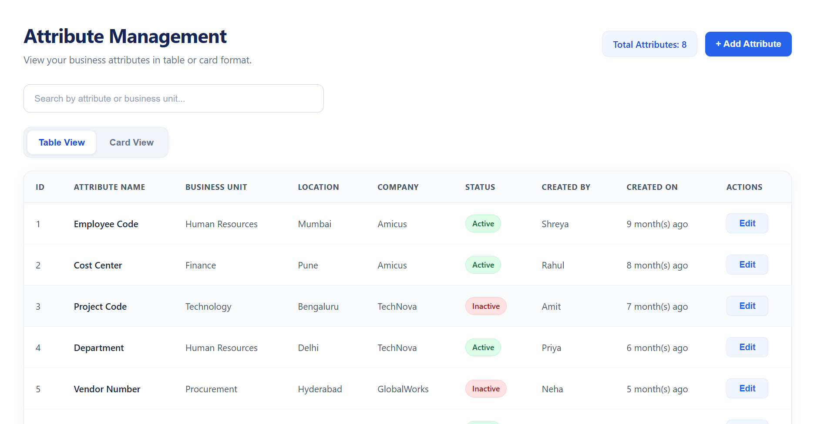

### 2. Attribute List — Card View
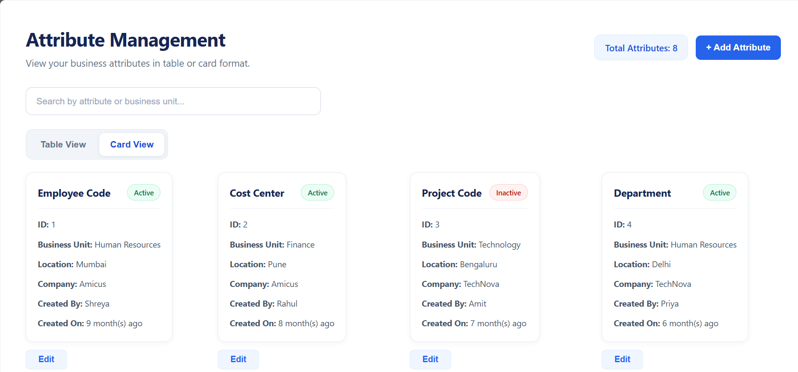

### 3. Add Attribute Form
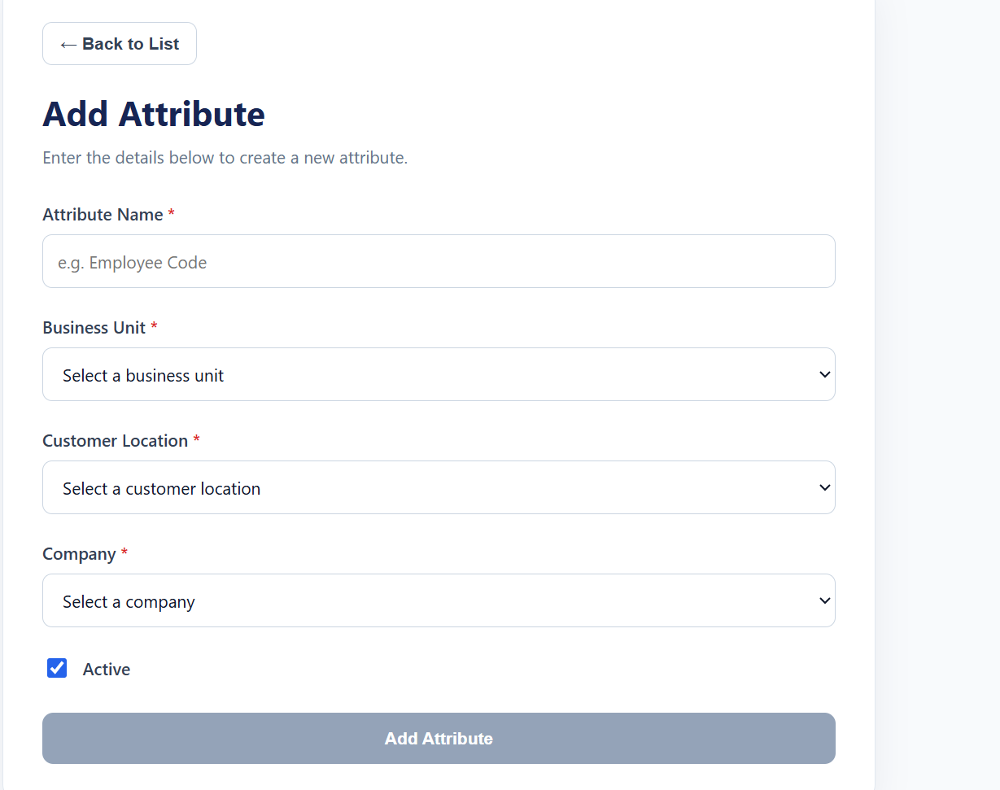

### 4. Edit Attribute Form
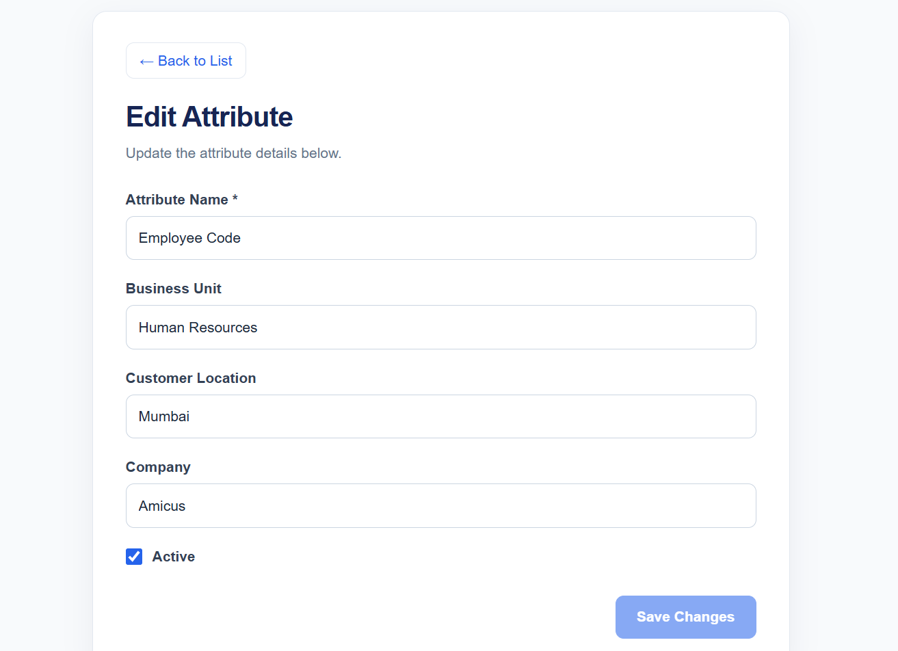

### 5. Search — Example 1
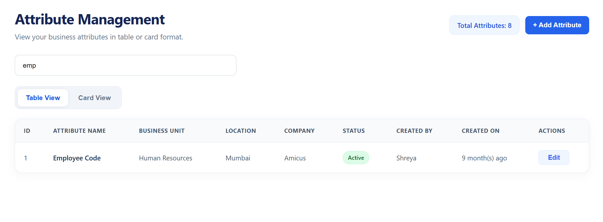

### 6. Search — Example 2
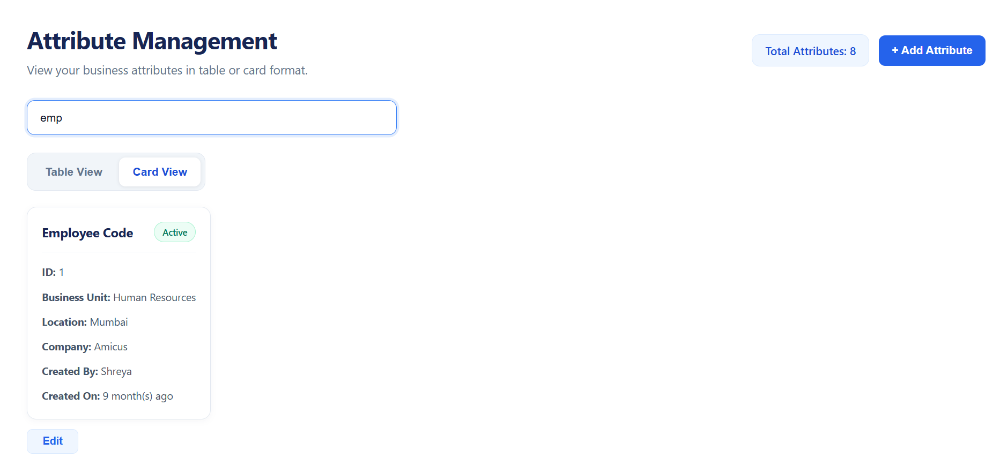

### 7. Console Output
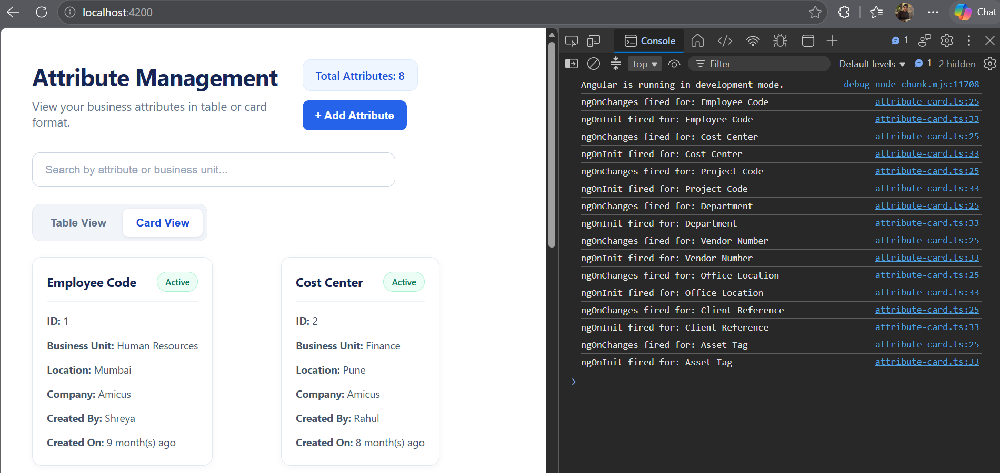


## Assignment 2 — Data Layer: Routing, RxJS, HTTP Integration & State Management

### 1. Restructure into feature modules:
   • AttributeModule (List, Card, Add, Edit components from Assignment 1)
   • SharedModule (directives, pipes, shared UI components)
   • CoreModule (services, interceptors)
   Write in README: Why separate Core from Shared? What goes where? What happens if you import CoreModule inside a lazy-loaded module?

``` bash
C:\CUSTOMAPPS\ANGULAR\ATTRIBUTEMANAGEMENTAPP\SRC\APP
|   app.config.ts
|   app.css
|   app.html
|   app.routes.ts
|   app.spec.ts
|   app.ts
|   
+---core
|   +---interceptors
|   \---services
+---features
|   \---attributes
|       +---components
|       |   \---attribute-card
|       |           attribute-card.css
|       |           attribute-card.html
|       |           attribute-card.spec.ts
|       |           attribute-card.ts
|       |           
|       +---models
|       |       attribute.model.ts
|       |       
|       +---pages
|       |   +---add-attribute
|       |   |       add-attribute.css
|       |   |       add-attribute.html
|       |   |       add-attribute.spec.ts
|       |   |       add-attribute.ts
|       |   |       
|       |   +---attribute-list
|       |   |       attribute-list.css
|       |   |       attribute-list.html
|       |   |       attribute-list.spec.ts
|       |   |       attribute-list.ts
|       |   |       
|       |   \---edit-attribute
|       |           edit-attribute.css
|       |           edit-attribute.html
|       |           edit-attribute.spec.ts
|       |           edit-attribute.ts
|       |           
|       \---services
|               attribute.spec.ts
|               attribute.ts
|               lookup.spec.ts
|               lookup.ts
|               
\---shared
    +---components
    +---directives
    |       active-status.spec.ts
    |       active-status.ts
    |       filter-by.spec.ts
    |       filter-by.ts
    |       
    \---pipes
            relative-time-pipe.spec.ts
            relative-time-pipe.ts
```


#### 1. Why separate Core from Shared?

Core and Shared are separated to maintain a clear separation of responsibilities.

- **Core:** Contains application-wide services and interceptors that provide functionality across the application.
- **Shared:** Contains reusable components, directives and pipes that can be used by multiple features.

This separation avoids mixing application-level functionality with reusable UI elements and utilities.

#### 2. What goes where?

| Folder | Contents |
|---|---|
| Core | Application-wide services, authentication services, HTTP interceptors |
| Shared | Reusable UI components, custom directives, pipes |
| Features/Attributes | Attribute List, Card, Add and Edit components, models and feature-specific services |

#### 3. What happens if CoreModule is imported inside a lazy-loaded module?

In the traditional NgModule architecture, a lazy-loaded module gets its own child injector. Importing CoreModule inside it can create duplicate instances of services intended to be singletons.

This may lead to unexpected behavior, such as multiple service instances or duplicate interceptor registrations.

Therefore, CoreModule should conventionally be imported only once in the root AppModule.


### 2. Set up routing:
   • /attributes → Attribute List (default)
   • /attributes/add → Add Attribute
   • /attributes/:id/edit → Edit Attribute
   • /dashboard → Dashboard placeholder
   • Wildcard → PageNotFoundComponent
   Implement lazy loading for AttributeModule. Verify via Network tab — take a screenshot showing the lazy-loaded chunk. Describe what you see.


   ``` ts
   import { Routes } from '@angular/router';

import { AttributeListComponent } from './pages/attribute-list/attribute-list';
import { AddAttributeComponent } from './pages/add-attribute/add-attribute';
import { EditAttributeComponent } from './pages/edit-attribute/edit-attribute';

export const ATTRIBUTE_ROUTES: Routes = [
  {
    path: '',
    component: AttributeListComponent
  },
  {
    path: 'add',
    component: AddAttributeComponent
  },
  {
    path: ':id/edit',
    component: EditAttributeComponent
  }
];

```

``` ts

import { Routes } from '@angular/router';

export const routes: Routes = [
  {
    path: 'attributes',
    loadChildren: () =>
      import('./features/attributes/attribute.routes')
        .then(m => m.ATTRIBUTE_ROUTES)
  },
  {
    path: 'dashboard',
    loadComponent: () =>
      import('./features/dashboard/dashboard')
        .then(m => m.DashboardComponent)
  },
  {
    path: '',
    redirectTo: 'attributes',
    pathMatch: 'full'
  },
  {
    path: '**',
    loadComponent: () =>
      import('./shared/components/page-not-found/page-not-found')
        .then(m => m.PageNotFoundComponent)
  }
];

```

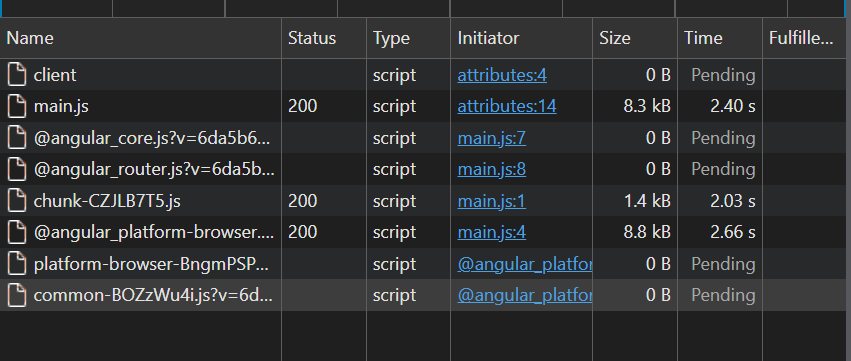


### 3. Create an AuthGuard (CanActivate): check a hardcoded isLoggedIn flag in AuthService. If not logged in, redirect to a LoginComponent (simple form, no real backend — just sets the flag). Protect /add and /edit routes.

auth.guard.ts

```
import { Injectable } from '@angular/core';
import {
  CanActivate,
  Router,
  UrlTree,
  ActivatedRouteSnapshot,
  RouterStateSnapshot
} from '@angular/router';

import { AuthService } from '../services/auth.service';

@Injectable({
  providedIn: 'root'
})
export class AuthGuard implements CanActivate {

  constructor(
    private authService: AuthService,
    private router: Router
  ) {}

  canActivate(
    route: ActivatedRouteSnapshot,
    state: RouterStateSnapshot
  ): boolean | UrlTree {

    if (this.authService.isLoggedIn) {
      return true;
    }

    return this.router.createUrlTree(
      ['/login'],
      {
        queryParams: {
          returnUrl: state.url
        }
      }
    );
  }
}
```
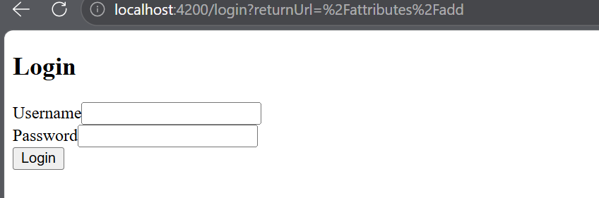


### 4. Create an UnsavedChangesGuard (CanDeactivate) for EditAttributeComponent. Must integrate with the dirty-check from Assignment 1 — if form is dirty, show a confirm dialog before navigating away.

``` ts
import { Injectable } from '@angular/core';
import {
  CanDeactivate
} from '@angular/router';

import {
  EditAttributeComponent
} from '../../features/attributes/pages/edit-attribute/edit-attribute';

@Injectable({
  providedIn: 'root'
})
export class UnsavedChangesGuard
  implements CanDeactivate<EditAttributeComponent> {

  canDeactivate(
    component: EditAttributeComponent
  ): boolean {

    if (!component.hasUnsavedChanges) {
      return true;
    }

    return window.confirm(
      'You have unsaved changes. Are you sure you want to leave?'
    );
  }
}
```

``` ts
 {
    path: ':id/edit',
    component: EditAttributeComponent,
    canActivate: [AuthGuard],
    canDeactivate: [UnsavedChangesGuard]
  }
```

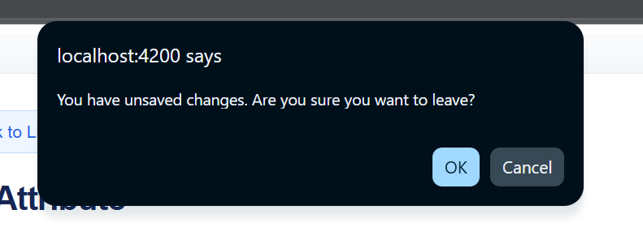


### 5. Create an AttributeResolver that pre-fetches attribute data before EditAttributeComponent loads. If the ID doesn't exist, redirect to /attributes with an error message via a ToastService you build from scratch (no third-party library).

``` ts
import { Injectable, inject } from '@angular/core';
import {
  Resolve,
  ActivatedRouteSnapshot,
  Router,
  RouterStateSnapshot,
  RedirectCommand
} from '@angular/router';

import { IAttribute } from '../models/attribute.model';
import { AttributeService } from '../services/attribute';
import { ToastService } from '../../../core/services/toast.service';

@Injectable({
  providedIn: 'root'
})
export class AttributeResolver implements Resolve<IAttribute | RedirectCommand> {

  private attributeService = inject(AttributeService);
  private router = inject(Router);
  private toastService = inject(ToastService);

  resolve(
    route: ActivatedRouteSnapshot,
    state: RouterStateSnapshot
  ): IAttribute | RedirectCommand {

    const id = Number(route.paramMap.get('id'));

    const attribute = this.attributeService.getAttributeById(id);

    if (!attribute) {
      this.toastService.showError(
        `Attribute with ID ${id} was not found.`
      );

      return new RedirectCommand(
        this.router.createUrlTree(['/attributes'])
      );
    }

    return attribute;
  }
}
```

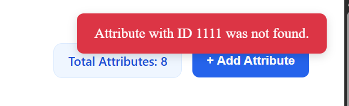

### 6. Set up json-server as a mock API. Configure environment.ts and environment.prod.ts with different API base URLs. No hardcoded URLs anywhere in services.


### JSON Server Setup
- Installed JSON Server as a development dependency.
- Created `db.json` containing mock attribute records.
- Configured the `api` script in package.json.
- Started the mock API using `npm run api`.
- API endpoint: `http://localhost:3000/attributes`.

### Environment Configuration
- Created `environment.ts` for development.
- Created `environment.prod.ts` for production.
- Configured Angular production file replacement in angular.json.
- Development API URL: `http://localhost:3000`.
- Production API URL: `https://api.example.com` (placeholder).

### HTTP Configuration
- Configured `provideHttpClient()` in app.config.ts.
- Updated AttributeService to use Angular HttpClient.
- Used environment.apiBaseUrl to construct API endpoints.
- No hardcoded API base URLs in services.

### API Operations
- GET: Retrieve all attributes and retrieve an attribute by ID.
- POST: Add a new attribute.
- PUT: Update an existing attribute.

### Testing
- Verified that all 8 mock records load successfully.
- Verified that newly added attributes persist in db.json.
- Verified that updated attributes persist in db.json.
- Confirmed that development API requests work successfully.

``` ts
export const environment = {
  production: true,
  apiBaseUrl: 'https://api.example.com'
};
```

``` ts
export const environment = {
  production: false,
  apiBaseUrl: 'http://localhost:3000'
};
```

### 7. Create a DTO mapping layer:
   • Define AttributeDTO with snake_case properties (attribute_id, attribute_name, business_unit_name, etc.) matching the API response format
   • Your IAttribute interface stays camelCase
   • Create a MappingService with toAttribute(dto) and toDTO(attribute) methods
   • ALL API responses must pass through the mapper before reaching components. Comment: Why not use the API response directly in components?


   ``` ts
   export interface AttributeDTO {
  attribute_id: number;
  attribute_name: string;
  business_unit_id: number;
  customer_location_id: number;
  company_id: number;
  business_unit_name: string;
  customer_location_name: string;
  company_name: string;
  is_active: boolean;
  created_on: string;
  created_by: string;
  updated_on: string | null;
  updated_by: string | null;
}
```

``` ts

import { Injectable } from '@angular/core';
import { IAttribute, AttributeDTO } from '../models/attribute.model';

@Injectable({
  providedIn: 'root'
})
export class MappingService {

  toAttribute(dto: AttributeDTO): IAttribute {
    return {
      attributeId: dto.attribute_id,
      attributeName: dto.attribute_name,
      businessUnitId: dto.business_unit_id,
      customerLocationId: dto.customer_location_id,
      companyId: dto.company_id,
      businessUnitName: dto.business_unit_name,
      customerLocationName: dto.customer_location_name,
      companyName: dto.company_name,
      isActive: dto.is_active,
      createdOn: new Date(dto.created_on),
      createdBy: dto.created_by,
      updatedOn: dto.updated_on ? new Date(dto.updated_on) : null,
      updatedBy: dto.updated_by
    };
  }

  toDTO(attribute: IAttribute): AttributeDTO {
    return {
      attribute_id: attribute.attributeId,
      attribute_name: attribute.attributeName,
      business_unit_id: attribute.businessUnitId,
      customer_location_id: attribute.customerLocationId,
      company_id: attribute.companyId,
      business_unit_name: attribute.businessUnitName,
      customer_location_name: attribute.customerLocationName,
      company_name: attribute.companyName,
      is_active: attribute.isActive,
      created_on: attribute.createdOn.toISOString(),
      created_by: attribute.createdBy,
      updated_on: attribute.updatedOn
        ? attribute.updatedOn.toISOString()
        : null,
      updated_by: attribute.updatedBy
    };
  }
}
```

### Why not use the API response directly in components?

We should not use API responses directly in components because the API and frontend may follow different data formats. The API uses snake_case properties, while Angular uses camelCase properties.

The MappingService converts API DTOs into application models and vice versa. This keeps components independent of the API structure, avoids repeated conversion logic, improves maintainability, and makes it easier to handle changes in the backend without modifying multiple components.


### 8. Replace in-memory AttributeService data with real HttpClient calls (GET list, GET by ID, POST create, PUT update, DELETE). LookupService calls should also be from the API.

attribute service

``` ts

import { Injectable, inject } from '@angular/core';
import { HttpClient } from '@angular/common/http';
import { Observable, map } from 'rxjs';

import { IAttribute } from '../models/attribute.model';
import { MappingService } from './mapping';
import { environment } from '../../../../environments/environment';
import { AttributeDTO } from '../dtos/attribute.dto';

@Injectable({
  providedIn: 'root'
})
export class AttributeService {

  private http = inject(HttpClient);
  private mappingService = inject(MappingService);

  private apiUrl = `${environment.apiBaseUrl}/attributes`;

  // Get all attributes
  getAttributes(): Observable<IAttribute[]> {
    return this.http.get<AttributeDTO[]>(this.apiUrl).pipe(
      map(dtos => dtos.map(dto => this.mappingService.toAttribute(dto)))
    );
  }

  // Get attribute by ID
  getAttributeById(id: number): Observable<IAttribute> {
    return this.http.get<AttributeDTO>(`${this.apiUrl}/${id}`).pipe(
      map(dto => this.mappingService.toAttribute(dto))
    );
  }

  // Add an attribute
  addAttribute(attribute: IAttribute): Observable<IAttribute> {
    const dto = this.mappingService.toDTO(attribute);

    return this.http.post<AttributeDTO>(this.apiUrl, dto).pipe(
      map(response => this.mappingService.toAttribute(response))
    );
  }

  // Update an attribute
  updateAttribute(
    id: number,
    attribute: IAttribute
  ): Observable<IAttribute> {
    const dto = this.mappingService.toDTO(attribute);

    return this.http.put<AttributeDTO>(
      `${this.apiUrl}/${id}`,
      dto
    ).pipe(
      map(response => this.mappingService.toAttribute(response))
    );
  }

  // Delete an attribute
  deleteAttribute(id: number): Observable<void> {
    return this.http.delete<void>(`${this.apiUrl}/${id}`);
  }
}
```

lookup service

``` ts

import { Injectable, inject } from '@angular/core';
import { HttpClient } from '@angular/common/http';
import { Observable, map } from 'rxjs';

import {
  IBusinessUnit,
  ICustomerLocation,
  ICompany
} from '../models/attribute.model';

import { BusinessUnitDTO } from '../dtos/business-unit.dto';
import { CustomerLocationDTO } from '../dtos/customer-location.dto';
import { CompanyDTO } from '../dtos/company.dto';
import { environment } from '../../../../environments/environment';

@Injectable({
  providedIn: 'root'
})
export class LookupService {

  private http = inject(HttpClient);

  private apiUrl = environment.apiBaseUrl;

  // Get all business units
  getBusinessUnits(): Observable<IBusinessUnit[]> {
    return this.http.get<BusinessUnitDTO[]>(
      `${this.apiUrl}/businessUnits`
    ).pipe(
      map(dtos => dtos.map(dto => ({
        businessId: dto.business_id,
        businessName: dto.business_name
      })))
    );
  }

  // Get all customer locations
  getCustomerLocations(): Observable<
    (ICustomerLocation & { businessUnitId: number })[]
  > {
    return this.http.get<CustomerLocationDTO[]>(
      `${this.apiUrl}/customerLocations`
    ).pipe(
      map(dtos => dtos.map(dto => ({
        customerLocationId: dto.customer_location_id,
        customerLocationName: dto.customer_location_name,
        businessUnitId: dto.business_unit_id
      })))
    );
  }

  // Get locations belonging to a selected business unit
  getLocationsByBusinessUnit(
    businessId: number
  ): Observable<ICustomerLocation[]> {
    return this.getCustomerLocations().pipe(
      map(locations =>
        locations.filter(
          location => location.businessUnitId === businessId
        )
      )
    );
  }

  // Get all companies
  getCompanies(): Observable<ICompany[]> {
    return this.http.get<CompanyDTO[]>(
      `${this.apiUrl}/companies`
    ).pipe(
      map(dtos => dtos.map(dto => ({
        companyId: dto.company_id,
        companyName: dto.company_name
      })))
    );
  }
}
```

### 9. Create an HttpInterceptor that:
   • Adds X-Request-Id header (UUID) to every outgoing request
   • Logs method, URL, and request duration to console
   • Handles 401 → redirect to login, 500 → user-friendly error via ToastService
   Comment: If you had 3 interceptors, in what order do they execute? How do you control the order?

``` ts

import { inject } from '@angular/core';
import {
  HttpInterceptorFn,
  HttpErrorResponse
} from '@angular/common/http';

import { Router } from '@angular/router';
import { catchError, finalize, throwError } from 'rxjs';

import { ToastService } from '../services/toast.service';

export const requestInterceptor: HttpInterceptorFn = (req, next) => {
  const router = inject(Router);
  const toastService = inject(ToastService);

  // Generate a unique request ID
  const requestId = crypto.randomUUID();

  // Add the request ID header
  const modifiedRequest = req.clone({
    setHeaders: {
      'X-Request-Id': requestId
    }
  });

  // Record request start time
  const startTime = performance.now();

  return next(modifiedRequest).pipe(
    catchError((error: HttpErrorResponse) => {

      if (error.status === 401) {
        router.navigate(['/login']);
      }

      if (error.status === 500) {
        toastService.showError(
          'Something went wrong on the server. Please try again later.'
        );
      }

      return throwError(() => error);
    }),

    finalize(() => {
      const duration = performance.now() - startTime;

      console.log(
        `[HTTP] ${req.method} ${req.urlWithParams} - ${duration.toFixed(2)} ms`
      );
    })
  );
};
```

#### How do multiple HTTP interceptors execute?

Functional HTTP interceptors execute in the order in which they are registered in `withInterceptors()`.

For example:

withInterceptors([
  authInterceptor,
  requestInterceptor,
  loggingInterceptor
])

Outgoing requests:
1. authInterceptor
2. requestInterceptor
3. loggingInterceptor

Incoming responses:
1. loggingInterceptor
2. requestInterceptor
3. authInterceptor

The execution order is controlled by the order of interceptors in the `withInterceptors()` array. Responses travel through the chain in reverse order.

### 10. Implement retry logic for GET requests only (retry 2 times, 1-second delay). Do NOT retry POST/PUT/DELETE. Comment: Why not retry mutation requests?

``` ts
  const request$ = req.method === 'GET'
    ? response$.pipe(
        retry({
          count: 2,
          delay: 1000
        })
      )
    : response$;
```

#### Why not retry mutation requests?

Mutation requests modify data on the server.

- POST may create duplicate records if a request succeeds on the server but its response is lost.
- PUT may repeat an update operation.
- DELETE may repeat a deletion request.

For example, retrying a POST request could create duplicate records if the first request succeeded but the client did not receive its response.

GET requests are generally safe to retry because they retrieve data without modifying server state.

Mutation requests should not be retried blindly. They require appropriate idempotency handling or application-specific retry mechanisms.

### 11. Refactor the search from Assignment 1: Replace the directive-based filtering with reactive search:
   • Use FormControl.valueChanges piped through debounceTime(300), distinctUntilChanged, switchMap to call a filtered API endpoint
   • Show a "Searching..." indicator during the debounce period
   Comment: Why debounceTime? Why distinctUntilChanged? What breaks without switchMap if this were a real API call?


``` ts
  searchAttributes(searchTerm: string): Observable<IAttribute[]> {
  return this.http.get<AttributeDTO[]>(this.apiUrl, {
    params: { q: searchTerm }
  }).pipe(
    map(dtos => dtos.map(dto => this.mappingService.toAttribute(dto)))
  );
}
```

``` html
<input
        type="text"
        placeholder="Search by attribute or business unit..."
        [formControl]="searchControl"
      />
```


#### Why use debounceTime?

`debounceTime(300)` waits for 300 milliseconds after the user stops typing before emitting the search value.

Without it, every keystroke would trigger an API request, resulting in unnecessary network traffic and server load.

#### Why use distinctUntilChanged?

`distinctUntilChanged()` prevents consecutive identical search values from triggering duplicate API requests.

Without it, unchanged values could cause unnecessary API calls.

#### What happens without switchMap?

Without `switchMap()`, previous API requests would continue executing even when the user enters a new search term.

This can cause:
- Unnecessary API requests.
- Multiple requests running simultaneously.
- Older search results arriving after newer results.
- Incorrect or outdated results being displayed.

`switchMap()` unsubscribes from the previous search Observable and switches to the latest one. With Angular HttpClient, unsubscribing also aborts the in-progress HTTP request.


### 12. Deliberately introduce these 3 bugs. Debug and fix them, documenting each in a BUGS.md:
   Bug A: Subscribe inside ngOnInit without unsubscribing. Navigate away and back 5 times. Open console — document what you see and why.
   Bug B: Use mergeMap instead of switchMap for search. Type quickly. Document the difference.
   Bug C: Use Subject instead of BehaviorSubject in a service. Navigate to a component that subscribes after a value was emitted. Document why it's empty.


### Bug A — Memory Leak Due to Unsubscribed Observable

#### Problem
An interval subscription was created inside `ngOnInit()` without unsubscribing.

#### Observation
After navigating away from Attribute List and returning multiple times, old interval subscriptions continued running.

This caused multiple subscriptions to remain active and produce console logs.

#### Cause
Angular destroys a component when navigating away, but it does not automatically unsubscribe manually created RxJS subscriptions.

#### Fix
Used Angular's `takeUntilDestroyed()` operator with `DestroyRef`.

```ts
interval(2000)
  .pipe(takeUntilDestroyed(this.destroyRef))
  .subscribe(count => {
    console.log('AttributeList subscription:', count);
  });
```

### Bug B — Using `mergeMap` Instead of `switchMap` for Search

#### Problem
Replaced `switchMap()` with `mergeMap()` in the reactive search implementation.

#### Observation
When typing search terms quickly, multiple API requests can remain active simultaneously.

Using network throttling helps demonstrate that requests may complete in a different order from the order in which they were sent.

As a result, an older search response can arrive after a newer response and overwrite the latest search results.

#### Cause
`mergeMap()` subscribes to every inner Observable and allows multiple requests to execute concurrently.

It does not cancel previous requests when a new search term is entered.

#### Fix
Replaced `mergeMap()` with `switchMap()`.

```ts
switchMap(searchTerm =>
  this.attributeService.searchAttributes(searchTerm).pipe(
    catchError(error => {
      console.error('Failed to search attributes:', error);

      this.toastService.showError(
        'Unable to search attributes. Please try again.'
      );

      return of([]);
    })
  )
)
```

### Result
`switchMap()` unsubscribes from the previous search Observable when a new search term is emitted.

For Angular HttpClient requests, unsubscribing also aborts the previous in-progress HTTP request.

Therefore, only the latest search request is allowed to update the displayed results.

### Difference Between mergeMap() and switchMap()

| mergeMap() | switchMap() |
|---|---|
| Keeps previous requests active | Unsubscribes from previous requests |
| Allows concurrent requests | Switches to the latest request |
| Responses may arrive out of order | Older responses are discarded |
| Useful when every request must complete | Useful for search and autocomplete |

**Conclusion:** `switchMap()` is more appropriate for reactive search because the latest search term should determine the displayed results.

### Bug C — Using Subject Instead of BehaviorSubject

#### Problem
Replaced `BehaviorSubject` with `Subject` in a service that shares data between components.

#### Observation
When a value was emitted before a component subscribed, the component did not receive that previously emitted value.

The component received only new values emitted after its subscription began.

#### Cause
A `Subject` does not store previously emitted values. It only sends values to its current subscribers.

A `BehaviorSubject` stores the latest emitted value and immediately provides that value to new subscribers.

#### Fix
Replaced `Subject` with `BehaviorSubject` and provided an initial value.

```ts
import { Injectable } from '@angular/core';
import { BehaviorSubject } from 'rxjs';

@Injectable({
  providedIn: 'root'
})
export class SharedDataService {

  private dataSubject = new BehaviorSubject<string>('');

  data$ = this.dataSubject.asObservable();

  updateData(value: string): void {
    this.dataSubject.next(value);
  }
}
```

#### Result
New subscribers immediately receive the latest value stored in the `BehaviorSubject`, even if that value was emitted before they subscribed.

#### Difference Between Subject and BehaviorSubject

| Subject | BehaviorSubject |
|---|---|
| Does not store the latest value | Stores the latest value |
| No initial value required | Requires an initial value |
| New subscribers receive future emissions only | New subscribers immediately receive the latest value |
| Does not replay previous values | Replays the latest value |


### 13. Build a centralized state approach using BehaviorSubject:
   • Create a StoreService that holds application state: attributes[], lookups, isLoading, isAuthenticated
   • Migrate AttributeService and AuthService to dispatch through the store
   • Components subscribe to store slices via async pipe
   • All state updates must be immutable (spread operator). Comment: Why immutability? What breaks if you mutate?


``` ts

import { Injectable } from '@angular/core';
import { BehaviorSubject, map } from 'rxjs';

import {
  IAttribute,
  IBusinessUnit,
  ICustomerLocation,
  ICompany
} from '../../features/attributes/models/attribute.model';

export interface AppState {
  attributes: IAttribute[];

  lookups: {
    businessUnits: IBusinessUnit[];
    customerLocations: (ICustomerLocation & {
      businessUnitId: number;
    })[];
    companies: ICompany[];
  };

  isLoading: boolean;
  isAuthenticated: boolean;
}

@Injectable({
  providedIn: 'root'
})
export class StoreService {

  private initialState: AppState = {
    attributes: [],

    lookups: {
      businessUnits: [],
      customerLocations: [],
      companies: []
    },

    isLoading: false,
    isAuthenticated: false
  };

  private stateSubject = new BehaviorSubject<AppState>(
    this.initialState
  );

  // Expose the complete application state
  state$ = this.stateSubject.asObservable();

  // Expose individual state slices
  attributes$ = this.state$.pipe(
    map(state => state.attributes)
  );

  lookups$ = this.state$.pipe(
    map(state => state.lookups)
  );

  isLoading$ = this.state$.pipe(
    map(state => state.isLoading)
  );

  isAuthenticated$ = this.state$.pipe(
    map(state => state.isAuthenticated)
  );

  // Get the current state
  getState(): AppState {
    return this.stateSubject.value;
  }

  // Update the complete state
  private updateState(newState: AppState): void {
    this.stateSubject.next(newState);
  }

  // Update attributes immutably
  setAttributes(attributes: IAttribute[]): void {
    this.updateState({
      ...this.getState(),
      attributes: [...attributes]
    });
  }

  // Add an attribute
  addAttribute(attribute: IAttribute): void {
    this.updateState({
      ...this.getState(),
      attributes: [
        ...this.getState().attributes,
        attribute
      ]
    });
  }

  // Update an existing attribute
  updateAttribute(attribute: IAttribute): void {
    this.updateState({
      ...this.getState(),
      attributes: this.getState().attributes.map(item =>
        item.attributeId === attribute.attributeId
          ? attribute
          : item
      )
    });
  }

  // Remove an attribute
  removeAttribute(id: number): void {
    this.updateState({
      ...this.getState(),
      attributes: this.getState().attributes.filter(
        item => item.attributeId !== id
      )
    });
  }

  // Update lookup data
  setLookups(lookups: AppState['lookups']): void {
    this.updateState({
      ...this.getState(),
      lookups: {
        ...lookups,
        businessUnits: [...lookups.businessUnits],
        customerLocations: [...lookups.customerLocations],
        companies: [...lookups.companies]
      }
    });
  }

  // Update loading status
  setLoading(isLoading: boolean): void {
    this.updateState({
      ...this.getState(),
      isLoading
    });
  }

  // Update authentication status
  setAuthenticated(isAuthenticated: boolean): void {
    this.updateState({
      ...this.getState(),
      isAuthenticated
    });
  }
}
```


## Why Immutability Matters

Immutability means creating new objects or arrays instead of directly modifying existing state.

### Example

```ts
// Immutable update
this.updateState({
  ...this.getState(),
  attributes: [...this.getState().attributes, newAttribute]
});

// Mutable update (Avoid)
this.getState().attributes.push(newAttribute);
```

### What Breaks If We Mutate?

- **Change Detection:** Reference-based checks may not detect changes.
- **UI Updates:** Components may display stale data.
- **Debugging:** Previous state cannot be reliably compared.
- **Side Effects:** Other components sharing the same reference may be affected.

**Conclusion:** Immutability creates predictable state updates, improves change detection, and makes debugging easier.

### 14. Create a LoaderComponent: Show a global loading spinner when any HTTP request is in flight. Must handle overlapping requests (spinner disappears only when ALL requests complete). Use the interceptor to manage the count.

``` ts

import { Component, inject } from '@angular/core';
import { AsyncPipe } from '@angular/common';
import { StoreService } from '../../../core/services/store';

@Component({
  selector: 'app-loader',
  standalone: true,
  imports: [AsyncPipe],
  templateUrl: './loader.html',
  styleUrl: './loader.css'
})
export class LoaderComponent {
  private store = inject(StoreService);

  isLoading$ = this.store.isLoading$;
}
```


## Assignment 3

### 1. Extend the AuthService/LoginComponent from Assignment 2:
   • Add role support: "Admin" and "Viewer" (store role in the BehaviorSubject store)
   • Admin can view, add, edit, delete attributes
   • Viewer can only view the attribute list (read-only)
   • Hide the "Add Attribute" button for Viewers. Disable edit/delete actions for Viewers.
   • Protect /attributes/add route with a RoleGuard (only Admin). If Viewer navigates to it directly via URL, redirect with a "Access denied" toast message.
   • Implement auto-logout after 10 minutes of inactivity: build an IdleService that tracks mouse/keyboard activity using RxJS (fromEvent, merge, switchMap, timer). On timeout, clear auth state and redirect to login.

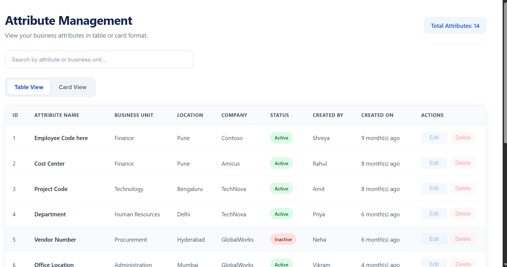
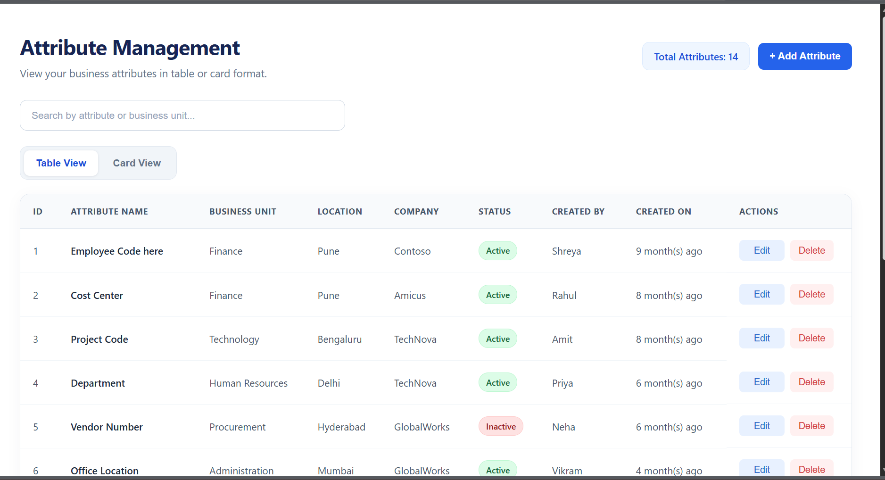


### 2. Add a user profile section in the header showing: logged-in username, role badge (styled with your appActiveStatus-style directive), and a logout button.


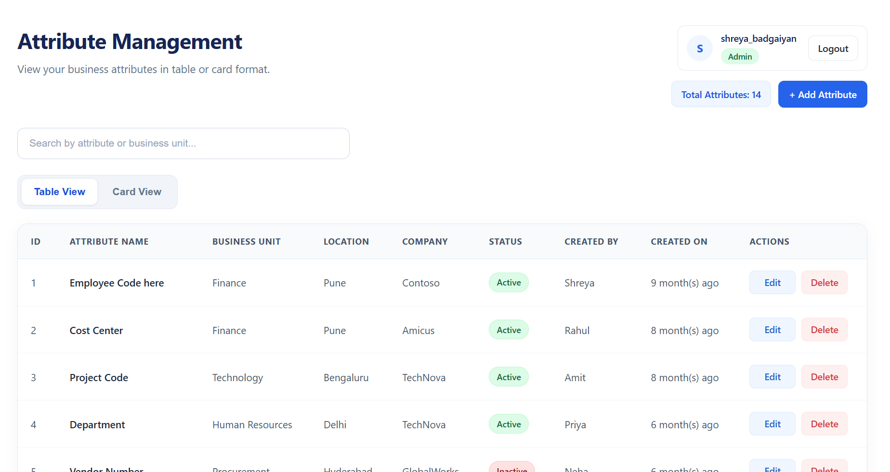


### 3. Build the Dashboard (placeholder from Assignment 2) with:
   • Summary cards: Total Attributes, Active Attributes, Inactive Attributes, Attributes Created This Month
   • A bar chart showing attribute count per Business Unit — build using SVG or Canvas. NO chart libraries (no Chart.js, no ng2-charts). You must draw the bars, labels, and axes yourself.
   • A recent activity widget showing last 10 create/edit/delete actions (create an ActivityLogService using ReplaySubject(10))
   • All dashboard data must reactively update when attributes change elsewhere in the app.

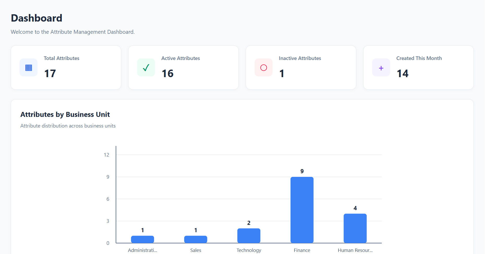

--- 

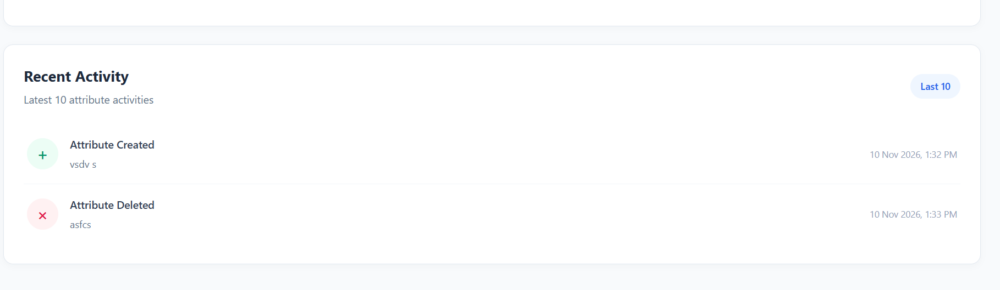


### 4. Create reusable UI components using content projection (ng-content):
   • CardWrapperComponent: provides consistent card styling (shadow, border, padding), consumer projects any content inside
   • CollapsibleSectionComponent: named slots for header and body (<ng-content select="[header]"> and <ng-content select="[body]">). Use it on Dashboard for each widget.
   • ConfirmDialogComponent: a modal dialog for delete confirmations. Built from scratch, no third-party.
   • DataTableComponent: a reusable sortable, paginated table. Refactor AttributeListComponent's table view to use this. Sorting and pagination must work with the API (pass sort/page params) not just client-side.


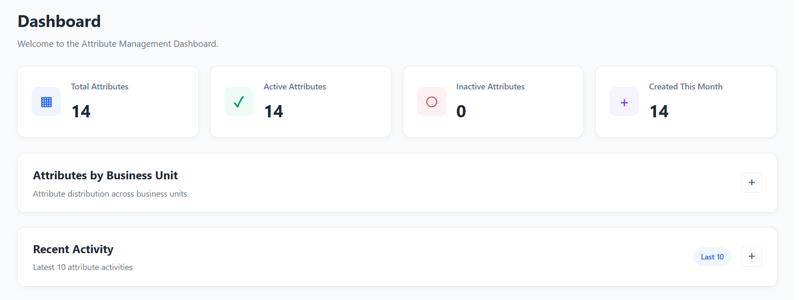

--- 

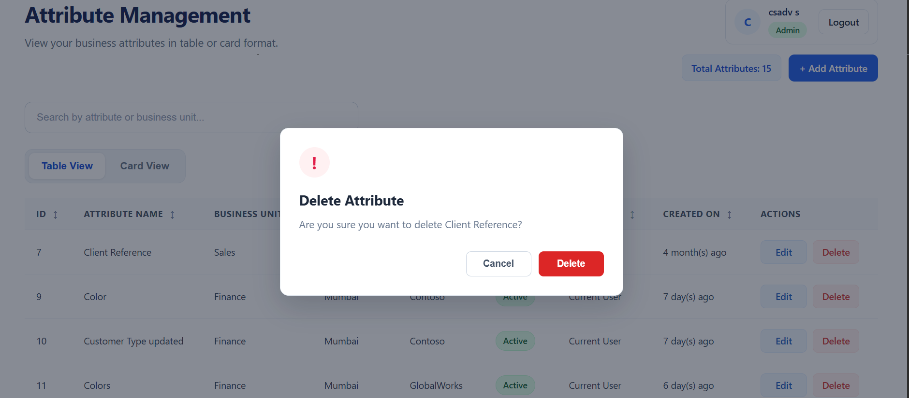

--- 

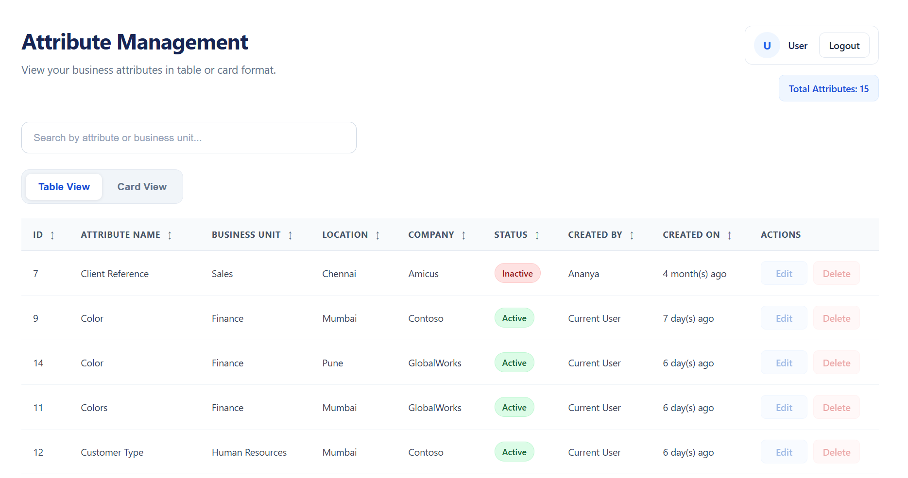


### 5. Baseline: Run a Chrome Lighthouse performance audit. Record the score. Screenshot the initial bundle sizes from the Network tab. Document in PERFORMANCE.md.

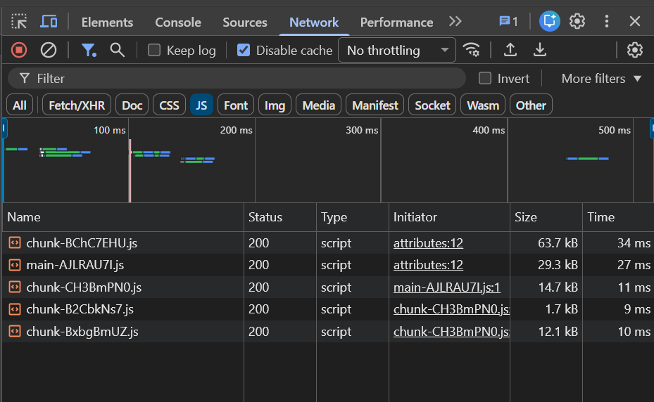

--- 


### 6. Switch ALL components to ChangeDetectionStrategy.OnPush. Some will break. For each broken component:
   • Document WHAT broke and WHY
   • Fix using the correct approach (immutable update, markForCheck(), async pipe — not by switching back to Default)
   • Explain why your fix works with OnPush

   ### Change Detection Optimization

- Applied `ChangeDetectionStrategy.OnPush` to all 14 components.
- Used `AsyncPipe`, Angular Signals, immutable updates, and `ChangeDetectorRef.markForCheck()` where required.
- Verified component functionality after the changes.
- Successfully built the application using `ng build`.

For implementation details, testing, and change detection explanations, see [CHANGE_DETECTION.md](./CHANGE_DETECTION.md).


### 7. Add trackBy to every *ngFor. Create a test: Add a "Refresh" button that reloads attributes from API. Without trackBy, observe all DOM nodes are recreated. With trackBy, only changed nodes update. Document the difference.

# Angular TrackBy and DOM Reuse

## 1. Overview

Angular uses tracking to identify items in a collection and efficiently update the DOM when the collection changes.

This project uses Angular's modern `@for` syntax instead of the older `*ngFor` directive.

The `track` expression identifies each item using a unique and stable key.

## 2. Tracking in This Project

All `@for` loops use tracking expressions.

Examples:

- Attributes: `track attribute.attributeId`
- Business Units: `track unit.businessId`
- Customer Locations: `track location.customerLocationId`
- Companies: `track company.companyId`
- Dashboard activities: `track activity.id`

The reusable DataTable accepts a tracking function from its parent component.

```typescript
trackAttributeById = (
  _index: number,
  attribute: IAttribute
): number => attribute.attributeId;
```

The function is passed to the DataTable:

```html
<app-data-table
  [data]="pagedAttributes"
  [trackByFn]="trackAttributeById"
/>
```

The DataTable uses it in its `@for` loop:

```html
@for (row of data; track trackByFn($index, row)) {
  <tr>
    ...
  </tr>
}
```

## 3. Refresh API Test

A Refresh button was added to reload attributes from the API.

```typescript
refreshAttributes(): void {
  this.loadAllAttributes();
  this.loadPagedAttributes();
}
```

This returns fresh JavaScript objects from the API, allowing DOM reuse to be tested.

## 4. Without Stable ID Tracking

For the first test, the tracking function returned the object itself:

```typescript
trackAttributeById = (
  _index: number,
  attribute: IAttribute
): IAttribute => attribute;
```

Angular compared object references to identify rows.

Since an API refresh creates new object instances, Angular treated the refreshed objects as different items and recreated the corresponding table row DOM nodes.

## 5. With Stable ID Tracking

For the second test, the tracking function returned the unique attribute ID:

```typescript
trackAttributeById = (
  _index: number,
  attribute: IAttribute
): number => attribute.attributeId;
```

Angular identified rows using their unique IDs.

After refreshing the API data, Angular reused existing DOM nodes for records whose IDs remained unchanged. Only necessary DOM updates were performed.

## 6. DOM Verification

Chrome DevTools Console was used to compare table row references before and after refreshing.

```javascript
window.beforeRows = [
  ...document.querySelectorAll('app-data-table tbody tr')
];
```

After clicking Refresh:

```javascript
window.afterRows = [
  ...document.querySelectorAll('app-data-table tbody tr')
];

console.table(
  window.beforeRows.map((row, index) => ({
    index,
    sameNode: row === window.afterRows[index]
  }))
);
```

### Observations

| Tracking approach | Expected DOM behavior |
|---|---|
| Object identity | Existing rows are recreated after API refresh |
| Stable attribute ID | Existing rows are reused |

## 7. Conclusion

Stable tracking improves rendering efficiency by allowing Angular to identify items using unique keys rather than object references.

It reduces unnecessary DOM recreation and is especially useful when working with API data, lists, tables, and frequently refreshed collections.