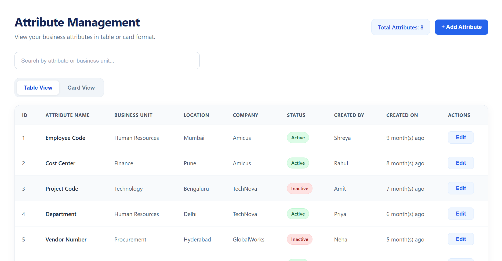
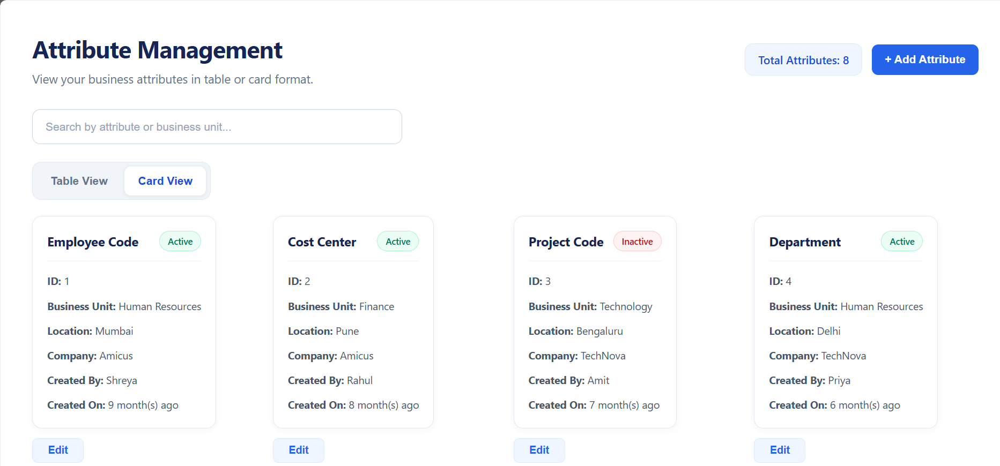
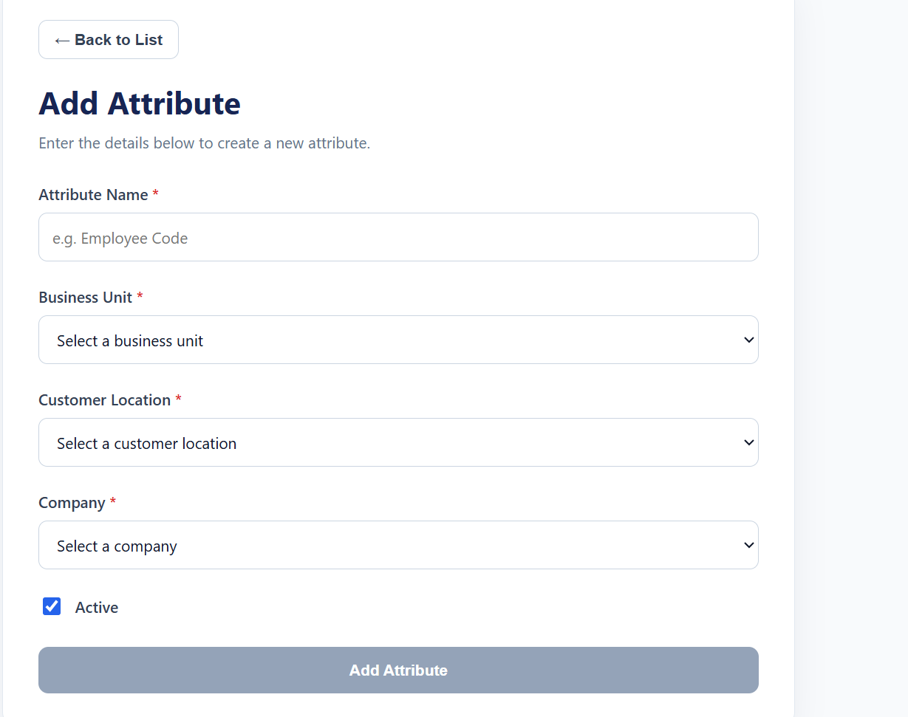
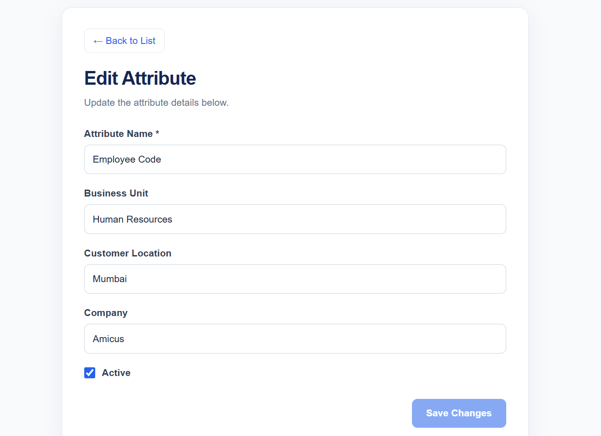
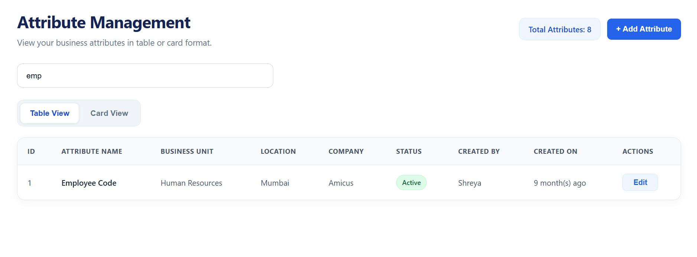
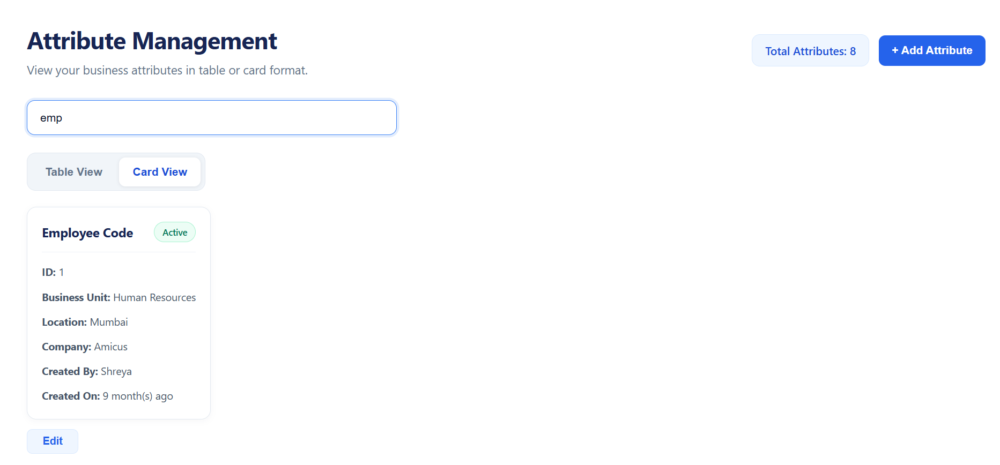
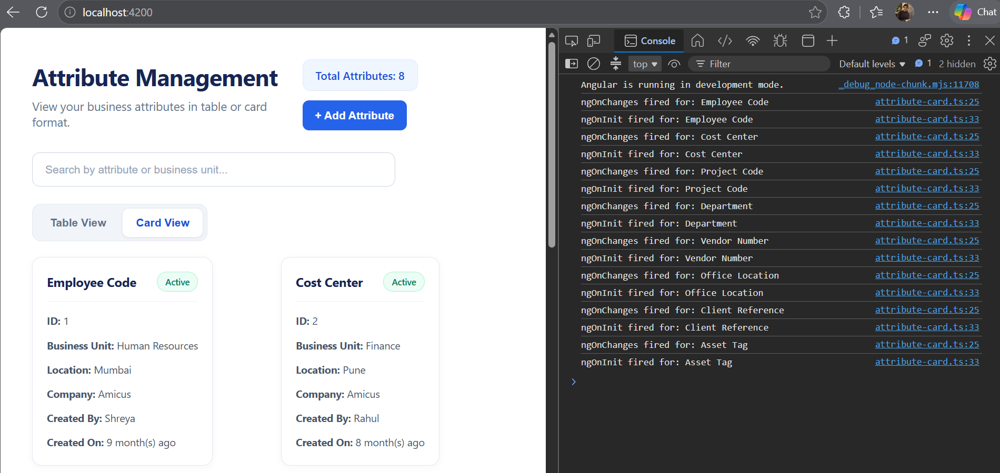

# AttributeManagementApp

This project was generated using [Angular CLI](https://github.com/angular/angular-cli) version 22.2.2.

## Development server

To start a local development server, run:

```bash
ng serve
```

Once the server is running, open your browser and navigate to `http://localhost:4200/`. The application will automatically reload whenever you modify any of the source files.

## Code scaffolding

Angular CLI includes powerful code scaffolding tools. To generate a new component, run:

```bash
ng generate component component-name
```

For a complete list of available schematics (such as `components`, `directives`, or `pipes`), run:

```bash
ng generate --help
```

## Building

To build the project run:

```bash
ng build
```

This will compile your project and store the build artifacts in the `dist/` directory. By default, the production build optimizes your application for performance and speed.

## Running unit tests

To execute unit tests with the [Vitest](https://vitest.dev/) test runner, use the following command:

```bash
ng test
```

## Running end-to-end tests

For end-to-end (e2e) testing, run:

```bash
ng e2e
```

Angular CLI does not come with an end-to-end testing framework by default. You can choose one that suits your needs.

## Additional Resources

For more information on using the Angular CLI, including detailed command references, visit the [Angular CLI Overview and Command Reference](https://angular.dev/tools/cli) page.


## Assignment 1

### 1. Create a new Angular application. Write a README section: Why does Angular offer both approaches? In what kind of project would you pick standalone over NgModule?

``` bash
ng new AttributeManagementApp
cd AttributeManagementApp
ng serve --open
```

## Why Angular Offers Standalone Components and NgModules

Angular offers both standalone components and NgModules to support different application structures and development needs.

**Standalone Components**

Standalone components do not need to be declared inside an NgModule. Their dependencies can be imported directly into the component, making the application structure easier to understand and maintain.

**NgModules**

NgModules group related components, directives, pipes, and services into a module. They were the traditional way to organize Angular applications and are still supported for existing projects and module-based architectures.

**When would I choose standalone components over NgModules?**

I would choose standalone components for a new application because they reduce module-related boilerplate, make dependencies explicit, and simplify component reuse. They are suitable for small, medium, and large applications.

NgModules can still be useful when maintaining an existing module-based application or working with a codebase that already relies on this architecture.

**Architecture chosen for this project**

This Attribute Management application uses a component-based architecture with standalone components. This keeps the application modular and makes its components easier to develop, test, and reuse in future assignments.

### 2. Create TypeScript interfaces:
   • IAttribute: AttributeId (number), AttributeName (string), BusinessUnitName (string), CustomerLocationName (string), CompanyName (string), IsActive (boolean), CreatedOn (Date), 
   CreatedBy (string), UpdatedOn (Date), UpdatedBy (string)
   • IBusinessUnit: BusinessId (number), BusinessName (string)
   • ICustomerLocation: CustomerLocationId (number), CustomerLocationName (string)
   • ICompany: CompanyId (number), CompanyName (string)
   Note: Choose appropriate TypeScript types. Do not use 'any' anywhere.


Create models folder inside app and create attribute.model.ts file
   ``` ts

   export interface IAttribute {
    AttributeId: number;
    AttributeName: string;
    BusinessUnitName: string;
    CustomerLocationName: string;
    CompanyName: string;
    IsActive: boolean;
    CreatedOn: Date;
    CreatedBy: string;
    UpdatedOn: Date|null;
    UpdatedBy: string|null;
}

export interface IBusinessUnit {
    BusinessId:number;
    BusinessName:string;
}

export interface ICustomerLocation {
    CustomerLocationId:number;
    CustomerLocationName:string;
}

export interface ICompany {
    CompanyId:number;
    CompanyName:string;
}

```

### 3. Create an AttributeService (root-level) with an in-memory array of at least 8 diverse Attribute records (mix of active/inactive, different business units, companies, locations, different creators). Write a comment: What would change if you provided this service at component level? When would you choose that?


``` bash

ng generate service services/attribute 

```
``` ts

import { Injectable } from '@angular/core';
import { IAttribute } from '../models/attribute.model';

@Injectable({
  providedIn: 'root'
})
export class AttributeService {

  private attributes: IAttribute[] = [
    {
      AttributeId: 1,
      AttributeName: 'Employee Code',
      BusinessUnitName: 'Human Resources',
      CustomerLocationName: 'Mumbai',
      CompanyName: 'Amicus',
      IsActive: true,
      CreatedOn: new Date('2026-01-10'),
      CreatedBy: 'Shreya',
      UpdatedOn: null,
      UpdatedBy: null
    },
    {
      AttributeId: 2,
      AttributeName: 'Cost Center',
      BusinessUnitName: 'Finance',
      CustomerLocationName: 'Pune',
      CompanyName: 'Amicus',
      IsActive: true,
      CreatedOn: new Date('2026-02-15'),
      CreatedBy: 'Rahul',
      UpdatedOn: new Date('2026-03-01'),
      UpdatedBy: 'Priya'
    },
    {
      AttributeId: 3,
      AttributeName: 'Project Code',
      BusinessUnitName: 'Technology',
      CustomerLocationName: 'Bengaluru',
      CompanyName: 'TechNova',
      IsActive: false,
      CreatedOn: new Date('2026-03-05'),
      CreatedBy: 'Amit',
      UpdatedOn: null,
      UpdatedBy: null
    },
    {
      AttributeId: 4,
      AttributeName: 'Department',
      BusinessUnitName: 'Human Resources',
      CustomerLocationName: 'Delhi',
      CompanyName: 'TechNova',
      IsActive: true,
      CreatedOn: new Date('2026-04-12'),
      CreatedBy: 'Priya',
      UpdatedOn: new Date('2026-05-02'),
      UpdatedBy: 'Shreya'
    },
    {
      AttributeId: 5,
      AttributeName: 'Vendor Number',
      BusinessUnitName: 'Procurement',
      CustomerLocationName: 'Hyderabad',
      CompanyName: 'GlobalWorks',
      IsActive: false,
      CreatedOn: new Date('2026-05-08'),
      CreatedBy: 'Neha',
      UpdatedOn: new Date('2026-06-10'),
      UpdatedBy: 'Rahul'
    },
    {
      AttributeId: 6,
      AttributeName: 'Office Location',
      BusinessUnitName: 'Administration',
      CustomerLocationName: 'Mumbai',
      CompanyName: 'GlobalWorks',
      IsActive: true,
      CreatedOn: new Date('2026-06-18'),
      CreatedBy: 'Vikram',
      UpdatedOn: null,
      UpdatedBy: null
    },
    {
      AttributeId: 7,
      AttributeName: 'Client Reference',
      BusinessUnitName: 'Sales',
      CustomerLocationName: 'Chennai',
      CompanyName: 'Amicus',
      IsActive: false,
      CreatedOn: new Date('2026-07-04'),
      CreatedBy: 'Ananya',
      UpdatedOn: null,
      UpdatedBy: null
    },
    {
      AttributeId: 8,
      AttributeName: 'Asset Tag',
      BusinessUnitName: 'Technology',
      CustomerLocationName: 'Pune',
      CompanyName: 'TechNova',
      IsActive: true,
      CreatedOn: new Date('2026-08-20'),
      CreatedBy: 'Rahul',
      UpdatedOn: new Date('2026-09-01'),
      UpdatedBy: 'Neha'
    }
  ];

  getAttributes(): IAttribute[] {
    return this.attributes;
  }


}

```
**What would change if you provided this service at component level? When would you choose that?**

If `AttributeService` is provided at the component level using `providers: [AttributeService]`, Angular creates a service instance within that component's injector scope. This means the component and its descendants can share that instance, while other components outside that scope may receive a different instance. I would choose component-level providers when a component needs isolated data or state that should not be shared across the application. For this project, I use `providedIn: 'root'` because the attribute data may need to be shared among multiple components.


### 4. Create AttributeListComponent that gets data from AttributeService and displays a table/grid of attributes. No wireframe given — you design the layout. Include columns you think are useful for a list view (you don't need to show all fields).

``` bash
ng generate component components/attribute-list
```

attribute-list.ts

``` ts


import { Component } from '@angular/core';
import { DatePipe } from '@angular/common';
import { AttributeService } from '../../services/attribute';
import { IAttribute } from '../../models/attribute.model';

@Component({
  selector: 'app-attribute-list',
  imports: [DatePipe],
  templateUrl: './attribute-list.html',
  styleUrl: './attribute-list.css'
})
export class AttributeList {
  attributes: IAttribute[] = [];

  constructor(private attributeService: AttributeService) {
    this.attributes = this.attributeService.getAttributes();
  }
}

```

attribute-list.html

``` html

<div class="page-container">
  <div class="page-header">
    <div>
      <h1>Attribute Management</h1>
      <p>View and manage your business attributes.</p>
    </div>

    <span class="record-count">
      Total Attributes: {{ attributes.length }}
    </span>
  </div>

  <div class="table-container">
    <table>
      <thead>
        <tr>
          <th>ID</th>
          <th>Attribute Name</th>
          <th>Business Unit</th>
          <th>Location</th>
          <th>Company</th>
          <th>Status</th>
          <th>Created By</th>
          <th>Created On</th>
        </tr>
      </thead>

      <tbody>
        @for (attribute of attributes; track attribute.AttributeId) {
          <tr>
            <td>{{ attribute.AttributeId }}</td>
            <td class="attribute-name">
              {{ attribute.AttributeName }}
            </td>
            <td>{{ attribute.BusinessUnitName }}</td>
            <td>{{ attribute.CustomerLocationName }}</td>
            <td>{{ attribute.CompanyName }}</td>
            <td>
              <span
                class="status"
                [class.active]="attribute.IsActive"
                [class.inactive]="!attribute.IsActive">
                {{ attribute.IsActive ? 'Active' : 'Inactive' }}
              </span>
            </td>
            <td>{{ attribute.CreatedBy }}</td>
            <td>{{ attribute.CreatedOn | date:'dd MMM yyyy' }}</td>
          </tr>
        } @empty {
          <tr>
            <td colspan="8" class="empty-message">
              No attributes found.
            </td>
          </tr>
        }
      </tbody>
    </table>
  </div>
</div>
```

app.html
``` html
<app-attribute-list />
```

app.ts

``` ts

imports: [RouterOutlet,AttributeList],

```

### 5. Create AttributeCardComponent (@Input: IAttribute) as an alternative view. Add a toggle button in AttributeListComponent to switch between Table View and Card View. This toggle must preserve the current search/filter state.

``` bash
ng generate component components/attribute-card
```

attribute-card.ts
``` ts

import { Component } from '@angular/core';
import { DatePipe } from '@angular/common';
import { AttributeService } from '../../services/attribute';
import { IAttribute } from '../../models/attribute.model';
import { AttributeCardComponent } from '../attribute-card/attribute-card';

@Component({
  selector: 'app-attribute-list',
  imports: [DatePipe, AttributeCardComponent],
  templateUrl: './attribute-list.html',
  styleUrl: './attribute-list.css'
})
export class AttributeListComponent {
  attributes: IAttribute[] = [];
  viewMode: 'table' | 'card' = 'table';

  constructor(private attributeService: AttributeService) {
    this.attributes = this.attributeService.getAttributes();
  }

  setView(mode: 'table' | 'card'): void {
    this.viewMode = mode;
  }
}
```

attribute-card.html

``` html

<div class="attribute-card">
  <div class="card-header">
    <h3>{{ attribute.AttributeName }}</h3>

    <span
      class="status"
      [class.active]="attribute.IsActive"
      [class.inactive]="!attribute.IsActive">
      {{ attribute.IsActive ? 'Active' : 'Inactive' }}
    </span>
  </div>

  <p><strong>ID:</strong> {{ attribute.AttributeId }}</p>
  <p><strong>Business Unit:</strong> {{ attribute.BusinessUnitName }}</p>
  <p><strong>Location:</strong> {{ attribute.CustomerLocationName }}</p>
  <p><strong>Company:</strong> {{ attribute.CompanyName }}</p>
  <p><strong>Created By:</strong> {{ attribute.CreatedBy }}</p>
  <p>
    <strong>Created On:</strong>
    {{ attribute.CreatedOn | date:'dd MMM yyyy' }}
  </p>
</div>
```

### 6. Implement ngOnInit, ngOnChanges, ngOnDestroy in AttributeCardComponent with console.log showing which hook fired and for which attribute. Run the app and document in a comment block:
   • In what order do hooks fire when the list loads?
   • What fires when you switch between table/card view?
   • What fires when you remove an attribute? What real-world cleanup would you do in ngOnDestroy?

   attribute-card.ts 

   ``` ts
   
import {
  Component,
  Input,
  OnInit,
  OnChanges,
  OnDestroy,
  SimpleChanges
} from '@angular/core';

import { DatePipe } from '@angular/common';
import { IAttribute } from '../../models/attribute.model';

@Component({
  selector: 'app-attribute-card',
  imports: [DatePipe],
  templateUrl: './attribute-card.html',
  styleUrl: './attribute-card.css'
})
export class AttributeCardComponent implements OnInit, OnChanges, OnDestroy {
  @Input({ required: true }) attribute!: IAttribute;

  ngOnChanges(changes: SimpleChanges): void {
    if (changes['attribute']) {
      console.log(
        'ngOnChanges fired for:',
        this.attribute.AttributeName
      );
    }
  }

  ngOnInit(): void {
    console.log(
      'ngOnInit fired for:',
      this.attribute.AttributeName
    );
  }

  ngOnDestroy(): void {
    console.log(
      'ngOnDestroy fired for:',
      this.attribute.AttributeName
    );
  }
}
```

### Lifecycle Hook Observations

**1. In what order do hooks fire when the list loads?**

When the attribute cards are created, `ngOnChanges()` fires first because Angular initializes the `@Input()` property. After that, `ngOnInit()` fires once for each card. This sequence repeats for each card as Angular creates the components.

**2. What fires when switching between Table View and Card View?**

When switching from Card View to Table View, the card components are destroyed, triggering `ngOnDestroy()` for each card. When switching back to Card View, Angular creates new card instances, so `ngOnChanges()` and then `ngOnInit()` fire again for each card.

**3. What fires when an attribute is removed? What real-world cleanup would you do in `ngOnDestroy()`?**

When an attribute is removed from the rendered list, Angular destroys its corresponding card component and calls `ngOnDestroy()`.

In real-world applications, `ngOnDestroy()` can be used to unsubscribe from manual RxJS subscriptions, clear timers, remove event listeners, and release resources to prevent memory leaks.

### 7. Create a custom attribute directive appActiveStatus that reads IsActive and dynamically applies a visual badge (green bg for active, red for inactive) with a tooltip showing "Active since <CreatedOn>" or "Inactive since <UpdatedOn>".


``` bash
ng generate directive directives/active-status
```

active-status.ts

``` ts

import { Directive, ElementRef, Input, OnChanges, Renderer2 } from '@angular/core';
import { IAttribute } from '../models/attribute.model';

@Directive({
  selector: '[appActiveStatus]',
  standalone: true
})
export class ActiveStatus implements OnChanges {
  @Input({ required: true }) appActiveStatus!: IAttribute;

  constructor(
    private elementRef: ElementRef,
    private renderer: Renderer2
  ) {}

  ngOnChanges(): void {
    const attribute = this.appActiveStatus;
    const element = this.elementRef.nativeElement;

    this.renderer.removeClass(element, 'active-badge');
    this.renderer.removeClass(element, 'inactive-badge');

    if (attribute.IsActive) {
      this.renderer.addClass(element, 'active-badge');

      const createdDate = new Date(attribute.CreatedOn);
      this.renderer.setAttribute(
        element,
        'title',
        `Active since ${createdDate.toLocaleDateString()}`
      );
    } else {
      this.renderer.addClass(element, 'inactive-badge');

      const updatedDate = attribute.UpdatedOn
        ? new Date(attribute.UpdatedOn)
        : null;

      const dateText = updatedDate
        ? updatedDate.toLocaleDateString()
        : 'unknown date';

      this.renderer.setAttribute(
        element,
        'title',
        `Inactive since ${dateText}`
      );
    }
  }
}
```

### 8. Create a custom pipe RelativeTimePipe: transforms a Date into human-readable relative time (e.g., "2 years 3 months ago", "5 days ago", "just now"). No third-party libraries allowed. Use it on CreatedOn/UpdatedOn columns.


``` bash
ng generate pipe pipes/relative-time
```

relative-time-pipe.ts

``` ts

import { Pipe, PipeTransform } from '@angular/core';

@Pipe({
  name: 'relativeTime',
  standalone: true
})
export class RelativeTimePipe implements PipeTransform {

  transform(value: Date | string | null): string {
    if (!value) {
      return 'Unknown date';
    }

    const date = new Date(value);

    if (isNaN(date.getTime())) {
      return 'Invalid date';
    }

    const now = new Date();
    const differenceInMs = now.getTime() - date.getTime();

    const seconds = Math.floor(differenceInMs / 1000);
    const minutes = Math.floor(seconds / 60);
    const hours = Math.floor(minutes / 60);
    const days = Math.floor(hours / 24);

    if (seconds < 60) {
      return 'Just now';
    }

    if (minutes < 60) {
      return `${minutes} minute(s) ago`;
    }

    if (hours < 24) {
      return `${hours} hour(s) ago`;
    }

    if (days < 30) {
      return `${days} day(s) ago`;
    }

    const months = Math.floor(days / 30);

    if (months < 12) {
      return `${months} month(s) ago`;
    }

    const years = Math.floor(days / 365);
    return `${years} year(s) ago`;
  }
}
```

``` html

<td>{{ attribute.CreatedOn | relativeTime }}</td>

```

### 9. Add a search box. Create a custom structural directive *appFilterBy that shows/hides attributes based on search term matching AttributeName or BusinessUnitName. Explain in a comment: Why did you use a directive here instead of a pipe to filter the array? When would a pipe be more appropriate?

``` bash
ng generate directive directives/filter-by
```

fliter-by.ts 

``` ts


import {
  Directive,
  Input,
  TemplateRef,
  ViewContainerRef,
  OnChanges
} from '@angular/core';

import { IAttribute } from '../models/attribute.model';

@Directive({
  selector: '[appFilterBy]',
  standalone: true
})
export class FilterBy implements OnChanges {
  @Input({ required: true }) appFilterBy!: IAttribute;
  @Input() appFilterByTerm = '';

  constructor(
    private templateRef: TemplateRef<unknown>,
    private viewContainer: ViewContainerRef
  ) {}

  ngOnChanges(): void {
    this.viewContainer.clear();

    const term = this.appFilterByTerm.trim().toLowerCase();

    const matches =
      this.appFilterBy.AttributeName.toLowerCase().includes(term) ||
      this.appFilterBy.BusinessUnitName.toLowerCase().includes(term);

    if (matches) {
      this.viewContainer.createEmbeddedView(this.templateRef);
    }
  }
}

```
attribute-list.html

``` html

  <div class="search-container">
    <input
      type="text"
      placeholder="Search by attribute or business unit..."
      [(ngModel)]="searchTerm"
    />
  </div>

  ```


**Why did you use a directive here instead of a pipe to filter the array?**

I used a custom structural directive, `*appFilterBy`, because the assignment requires controlling the visibility of individual attribute views based on the search term. The directive uses Angular's `TemplateRef` and `ViewContainerRef` to dynamically create or remove views for matching attributes.

**When would a pipe be more appropriate?**

A pipe would be more appropriate when the goal is to transform an array into a filtered array for display. For example, a custom pipe could return only the attributes whose `AttributeName` or `BusinessUnitName` matches the search term. Pipes are generally suited to data transformation, whereas structural directives control whether template content is rendered.

### 10. Create AddAttributeComponent with a REACTIVE form (FormGroup/FormControl):
   • AttributeName: required, min 3 chars, custom sync validator — must not contain special characters except spaces and hyphens
   • BusinessUnit: required, dropdown populated from a LookupService (returns IBusinessUnit[])
   • CustomerLocation: required, dropdown from LookupService (returns ICustomerLocation[])
   • Company: required, dropdown from LookupService (returns ICompany[])
   • IsActive: checkbox, default true
   • Dependent dropdown: When BusinessUnit changes, CustomerLocation dropdown must filter to show only locations relevant to that business unit. Design the data relationship yourself in LookupService.
   Show validation errors only after field is touched or form submitted. Red border on invalid fields. Disabled submit button with tooltip when invalid.

``` bash
ng generate service services/lookup
```

lookup.ts

``` ts

import { Injectable } from '@angular/core';
import {
  IBusinessUnit,
  ICustomerLocation,
  ICompany
} from '../models/attribute.model';

@Injectable({
  providedIn: 'root'
})
export class LookupService {

  private businessUnits: IBusinessUnit[] = [
    { BusinessId: 1, BusinessName: 'Engineering' },
    { BusinessId: 2, BusinessName: 'Finance' },
    { BusinessId: 3, BusinessName: 'Human Resources' },
    { BusinessId: 4, BusinessName: 'Operations' }
  ];

  private customerLocations: (ICustomerLocation & {
    BusinessId: number;
  })[] = [
    { CustomerLocationId: 1, CustomerLocationName: 'Delhi', BusinessId: 1 },
    { CustomerLocationId: 2, CustomerLocationName: 'Bengaluru', BusinessId: 1 },
    { CustomerLocationId: 3, CustomerLocationName: 'Mumbai', BusinessId: 2 },
    { CustomerLocationId: 4, CustomerLocationName: 'Pune', BusinessId: 2 },
    { CustomerLocationId: 5, CustomerLocationName: 'Hyderabad', BusinessId: 3 },
    { CustomerLocationId: 6, CustomerLocationName: 'Chennai', BusinessId: 3 },
    { CustomerLocationId: 7, CustomerLocationName: 'Gurugram', BusinessId: 4 },
    { CustomerLocationId: 8, CustomerLocationName: 'Noida', BusinessId: 4 }
  ];

  private companies: ICompany[] = [
    { CompanyId: 1, CompanyName: 'Amicus' },
    { CompanyId: 2, CompanyName: 'Contoso' },
    { CompanyId: 3, CompanyName: 'Fabrikam' }
  ];

  getBusinessUnits(): IBusinessUnit[] {
    return this.businessUnits;
  }

  getCustomerLocations(): ICustomerLocation[] {
    return this.customerLocations;
  }

  getLocationsByBusinessUnit(
    businessId: number
  ): ICustomerLocation[] {
    return this.customerLocations.filter(
      location => location.BusinessId === businessId
    );
  }

  getCompanies(): ICompany[] {
    return this.companies;
  }
}
```

addAttribute

``` ts
addAttribute(newAttribute: IAttribute): void {
  const nextId = this.attributes.length > 0
    ? Math.max(
        ...this.attributes.map(attribute => attribute.AttributeId)
      ) + 1
    : 1;

  const attributeWithId: IAttribute = {
    ...newAttribute,
    AttributeId: nextId
  };

  this.attributes = [...this.attributes, attributeWithId];

  this.successMessage =
    `"${attributeWithId.AttributeName}" added successfully!`;

}
```


### 11. Create EditAttributeComponent using TEMPLATE-DRIVEN form (ngModel) for the same fields, pre-populated from existing data. Implement dirty-check: show "You have unsaved changes" warning if user tries to navigate away from a modified form.

``` bash
ng generate component components/edit-attribute
```

edit-attribute.ts

``` ts

import { Component, EventEmitter, Input, Output } from '@angular/core';
import { FormsModule } from '@angular/forms';
import { IAttribute } from '../../models/attribute.model';

@Component({
  selector: 'app-edit-attribute',
  standalone: true,
  imports: [FormsModule],
  templateUrl: './edit-attribute.html',
  styleUrl: './edit-attribute.css'
})
export class EditAttributeComponent {
  @Input({ required: true }) attribute!: IAttribute;
  @Output() save = new EventEmitter<IAttribute>();
  @Output() cancel = new EventEmitter<void>();

  editedAttribute!: IAttribute;
  originalAttribute!: IAttribute;

  ngOnInit(): void {
    this.originalAttribute = { ...this.attribute };
    this.editedAttribute = { ...this.attribute };
  }

  get hasUnsavedChanges(): boolean {
    return Object.keys(this.originalAttribute).some(
      key =>
        this.originalAttribute[key as keyof IAttribute] !==
        this.editedAttribute[key as keyof IAttribute]
    );
  }

  onSave(): void {
    this.save.emit({ ...this.editedAttribute });
  }

  onCancel(): void {
    if (this.hasUnsavedChanges) {
      const leave = confirm('You have unsaved changes. Are you sure you want to leave?');

      if (!leave) {
        return;
      }
    }

    this.cancel.emit();
  }
}
```

### 12. Write a comparison (comment block or README section): What was easier/harder between Reactive and Template-driven for this specific form? When would you choose each in a real project? Which is easier to unit test and why?


#### 1. Comparison

- **Reactive Forms (Add Attribute):** Easier to manage complex validation, custom validators, and dependent dropdowns. Requires more TypeScript setup.
- **Template-Driven Forms (Edit Attribute):** Easier to set up for simple forms using `ngModel`, but complex logic can become harder to maintain.

#### 2. When to Choose Each?

- **Reactive Forms:** Best for complex forms with multiple validations, dynamic fields, and business rules.
- **Template-Driven Forms:** Best for simple forms with basic inputs and validation.

#### 3. Which Is Easier to Unit Test?

Reactive Forms are generally easier to unit test because the form model and validators are explicitly defined in TypeScript. We can test form values and validation without rendering the HTML template.

**Conclusion:** Reactive Forms suit complex applications, while Template-Driven Forms work well for simpler forms.

## Application Screenshots

### 1. Attribute List — Table View


### 2. Attribute List — Card View


### 3. Add Attribute Form


### 4. Edit Attribute Form


### 5. Search — Example 1


### 6. Search — Example 2


### 7. Console Output

